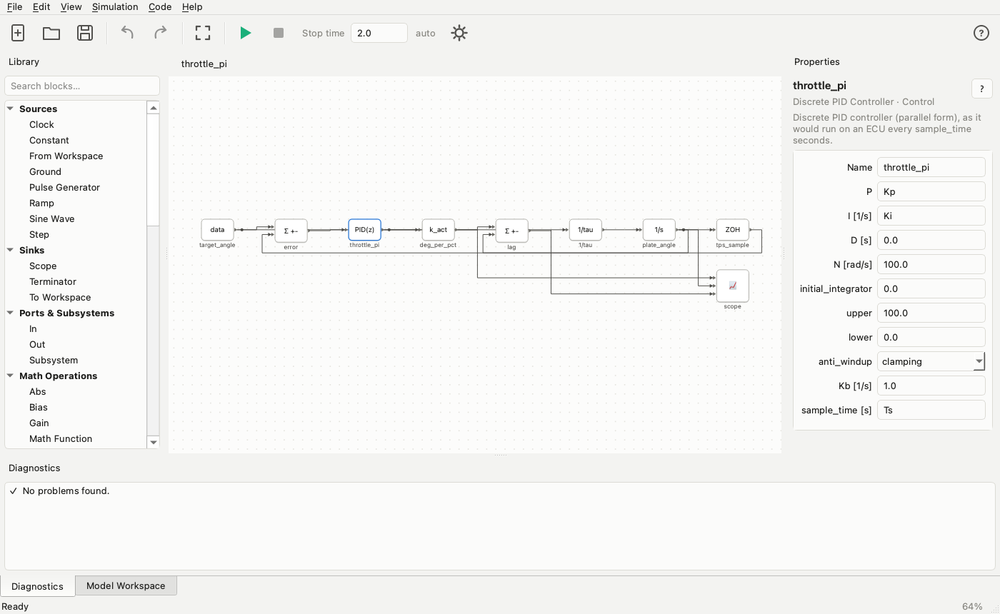
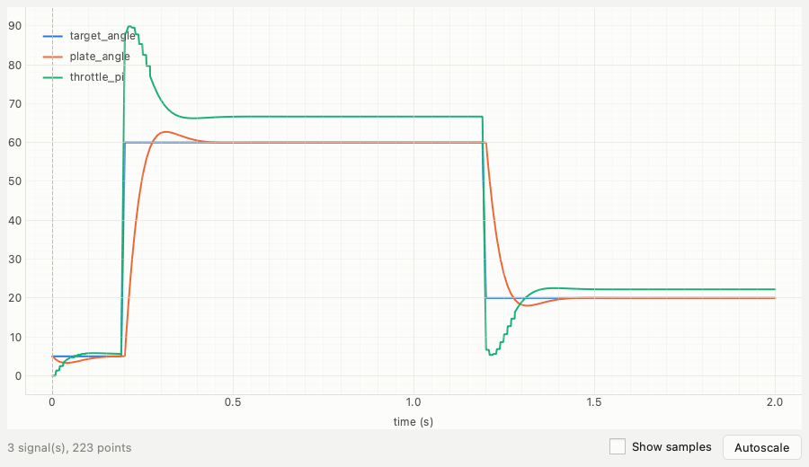

# Nervus

**Open-source block-diagram modeling and simulation in Python — an alternative to Simulink.**

*Nervus* is Latin for *nerve*. An engine control unit (ECU) is a vehicle's nervous system, and Nervus aims to be a
tool for designing, simulating and eventually generating C code for that kind of control software.



> **Status: pre-alpha.** The simulation engine and core blocks are under active development. See
> [`plan.md`](plan.md) for the roadmap.

## Goals

- A **headless simulation engine** in pure Python (NumPy/SciPy) that can be scripted, tested and run in CI.
- A **clean, modern desktop editor** built with PySide6 (Qt), using a Model–View–Controller architecture.
- A **block library** for control engineering, with automotive blocks such as engine and vehicle dynamics models,
  lookup tables and state machines.
- **C code generation** for embedded targets (ECUs), verified against the Python simulation (working:
  see below).
- **Git-friendly model files**: plain JSON that can be diffed and reviewed.

## Installation (development)

Nervus uses [uv](https://docs.astral.sh/uv/) to manage the environment.

```bash
git clone git@github.com:ikjbi/nervus.git
cd nervus
uv sync                 # engine + dev tools
uv sync --extra gui     # also install the desktop editor (PySide6, pyqtgraph, matplotlib)
```

## The editor

```bash
uv run nervus examples/throttle_pi.nervus
```

Drag blocks from the library, connect ports, edit parameters, press **▶ Run** and look at the scopes. Press
**F1** on any block for its help page, with equations and figures. See [docs/editor.md](docs/editor.md).



## C code for the ECU

Select the controller subsystem and choose **Code → Generate C Code**. You get `model.h`/`model.c` with
`model_initialize()` and `model_step()`, static memory only, and calibratable parameters. A
software-in-the-loop check compiles the code and compares it with the model step by step. See
[docs/codegen.md](docs/codegen.md) and the generated example in
[examples/generated/ECU](examples/generated/ECU).

## Quick start (Python)

```python
from nervus import Diagram, simulate
from nervus.blocks import Step, Sum, Gain, Integrator, Scope

# First-order system: dy/dt = (u - y) / tau
d = Diagram("first_order")
u = d.add(Step(time=0.0, final=1.0), name="u")
err = d.add(Sum(signs="+-"), name="err")
k = d.add(Gain(gain=1 / 0.5), name="1/tau")
y = d.add(Integrator(), name="y")
scope = d.add(Scope(num_inputs=2), name="scope")

d.connect(u, err.in_port(0))
d.connect(y, err.in_port(1))
d.chain(err, k, y)
d.connect(u, scope.in_port(0))
d.connect(y, scope.in_port(1))

res = simulate(d, t_final=3.0)
print(res["y"][-1])  # ≈ 1 - exp(-6)
```

More examples are in [`examples/`](examples/).

## Documentation

The user guide and block reference are in [`docs/`](docs/). To build them locally:

```bash
uv run --group docs mkdocs serve
```

## Development

```bash
uv run pytest          # tests
uv run ruff check .    # lint
uv run ruff format .   # format
uv run mypy            # type check
```

See [CONTRIBUTING.md](CONTRIBUTING.md).

## Safety

Code generated by Nervus is for learning, bench testing and off-road experiments. **Do not run it on a vehicle on
public roads.** Production automotive software requires ISO 26262 processes, qualified tools and certified code.

## License

[MIT](LICENSE)
