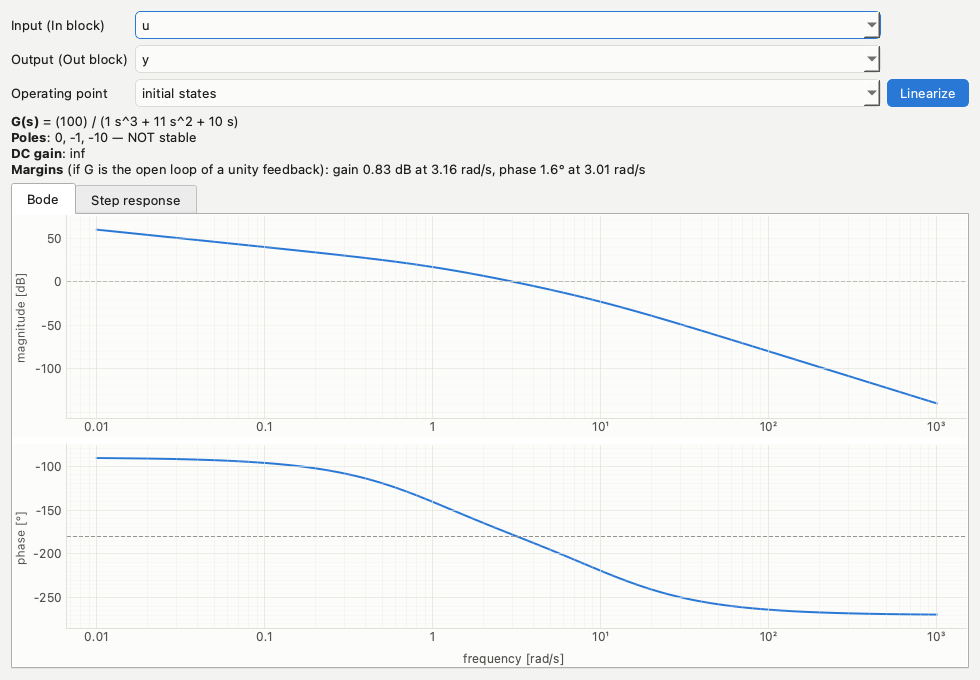
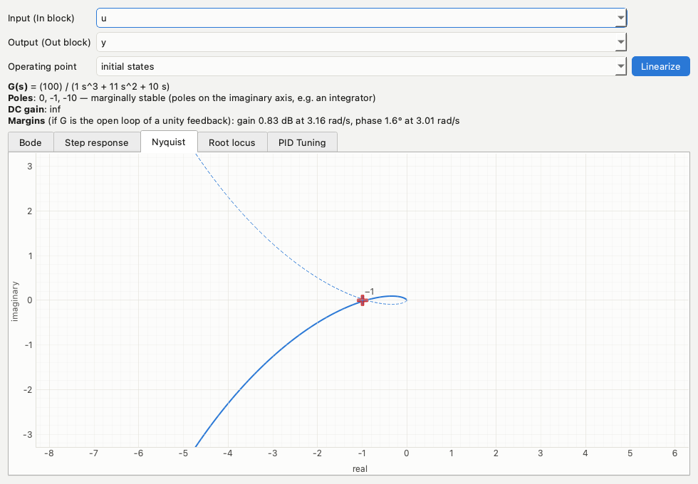
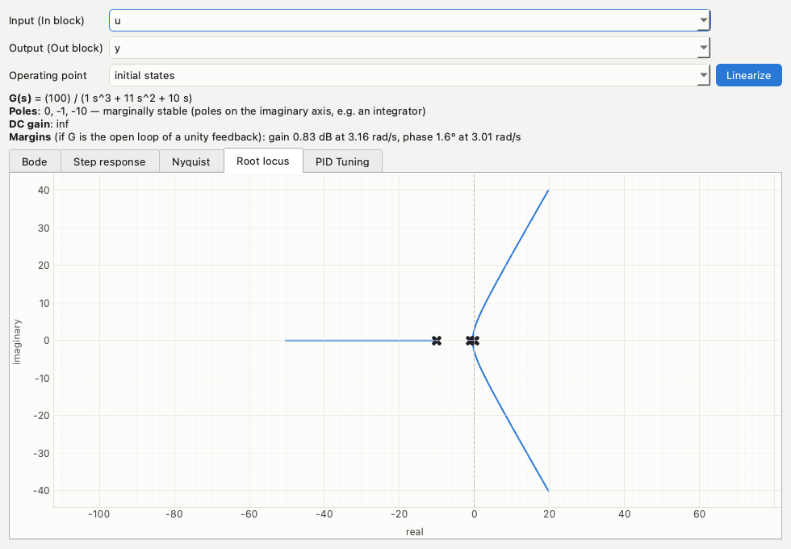
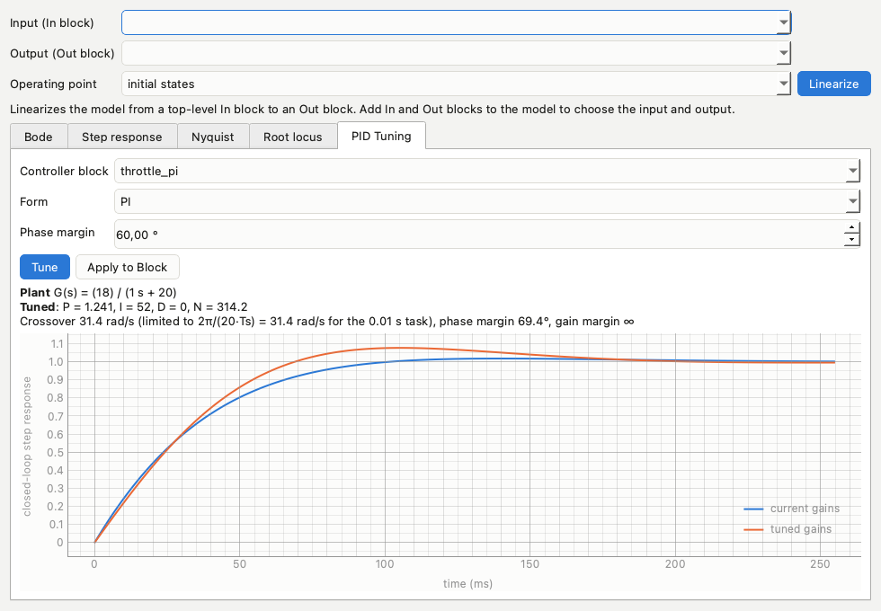

# Linear analysis

Controller design starts from a linear model of the plant. **Analysis → Linear Analysis…** (⌘L / Ctrl+L)
linearizes the model from a top-level **In** block to an **Out** block and shows:

- the transfer function G(s), its poles and stability, and the DC gain,
- the **Bode plot** (magnitude and phase),
- the **gain and phase margins**, read as if G were the open loop of a unity-feedback system,
- the step response of G, and of the closed loop G / (1 + G),
- the **Nyquist** plot and the **root locus** (the poles of the closed loop as the gain grows), with the
  open-loop poles (×) and zeros (○),
- **PID Tuning**: gains for a PID Controller block in the model.



Choose the operating point: the model's **initial states**, or the **steady state** (trim) for the In blocks'
values. Nonlinear models are linearized around that point with central differences.

## Nyquist and root locus

The **Nyquist** tab draws G(jω) for positive (solid) and negative (dashed) frequencies. The closed loop is
stable when the curve does not encircle the point −1 (for a stable open loop); how close it passes is the
margin. Curves that go to infinity (an integrator) are zoomed to the region around −1.

The **Root locus** tab shows where the closed-loop poles of k·G(s) go as the gain k grows from 0: they start
at the open-loop poles (×) and end at the zeros (○) or at infinity. Where a branch crosses into the right
half plane, the loop becomes unstable. The example above, L(s) = 10/(s(s+1)(0.1s+1)), crosses the imaginary
axis close to k = 1: its 1.6° phase margin.





## PID tuning

The **PID Tuning** tab needs no In or Out blocks: choose a PID Controller (or Discrete PID) block of the model,
PI or PID, and the phase margin you want, then press **Tune**:

1. Nervus opens the loop at the block's output and linearizes the **plant the controller sees**, from its
   output back to its input. The controller's input is the error *r − y*, so the plant is the negative of that
   transfer function.
2. It shapes the loop: a PI has its zero at ωc/4 (integral time Ti = 4/ωc), a PID also a derivative with
   Td = Ti/4 and its filter at 10·ωc. The proportional gain makes |C·G| = 1 at the crossover frequency ωc.
3. It takes the **fastest** ωc that still gives the phase margin, a gain margin of at least 6 dB and a stable
   closed loop. For a discrete controller ωc is limited to 2π/(20·Ts), a twentieth of the sample rate. If the
   limit leaves phase margin to spare, the integral action is made faster (smaller Ti) until it is used.

The plot compares the closed-loop step responses with the current and the tuned gains. **Apply to Block**
writes the gains; when a gain is a workspace variable (`P = Kp`), the variable is changed instead, so the
calibration stays in the workspace. Both can be undone.



The tuned gains are a robust starting point, not the last word: a plant that is well known allows more (the
throttle example's own gains place the integral zero on the plant's pole and settle without overshoot).
Discrete blocks without state (sampling, gains) pass the signal while the plant is linearized; discrete
blocks with state (filters, delays) are held, so they cut the loop.

## In Python

```python
from nervus import load
from nervus.analysis import linearize, trim

model = load("plant.nervus")  # with In and Out blocks
op = trim(model, {"throttle": 5.0})  # steady state for a constant input
lin = linearize(model, x0=op.x, u0=op.u)

lin.A, lin.B, lin.C, lin.D  # state-space matrices
num, den = lin.transfer_function()
lin.poles(), lin.dc_gain(), lin.is_stable()
w, mag_db, phase_deg = lin.bode()
m = lin.margins()  # m.gain_margin_db, m.phase_margin_deg, crossover frequencies
t, y = lin.step_response()
re, im = lin.nyquist()
gains, poles = lin.root_locus()
num_cl, den_cl = lin.closed_loop()  # G / (1 + G)
```

PID tuning from Python:

```python
from nervus.analysis import plant_at, tune_pid

plant = plant_at(model, "ECU/idle_pi")  # the loop opened at a controller block
gains = tune_pid(plant, "PID", phase_margin=60, max_crossover=2 * 3.1416 / (20 * 0.01))
gains.P, gains.I, gains.D, gains.N, gains.crossover, gains.phase_margin
```

### Example: the tank

For a tank with level h, inflow q and outflow $k\sqrt h$:

$$ A \dot h = q - k \sqrt h $$

`trim` finds the level where inflow and outflow balance, $h_0 = (q/k)^2$. `linearize` gives the local
time constant $\tau = 2 A \sqrt{h_0} / k$: the tank reacts more slowly when it is fuller. The test suite
checks exactly this (`tests/test_analysis.py`).

## Limitations

- Inputs and outputs must be scalar; the model's continuous states are linearized and discrete blocks are
  held at their current outputs.
- Margins assume a single-input, single-output loop.
