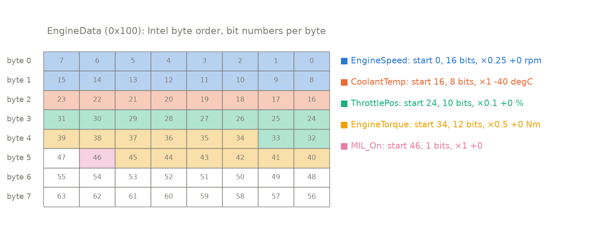

# CAN

## CAN Unpack

`can.unpack` · CAN

Decodes a CAN frame: the input is the frame's data bytes (a vector: 8 for classic CAN, up to 64 for CAN
FD), and there is one output per signal, in physical units (``raw · factor + offset`` from the DBC file).

Intel (little-endian) and Motorola (big-endian) byte order, signed and unsigned signals are supported.
**Multiplexed** signals are only in the frame when the multiplexer selects them; their outputs hold the
last value received. The block can be generated as C code.

### Parameters

| Name | Default | Unit | Description |
|---|---|---|---|
| `dbc_file` | `''` |  | DBC file (relative paths are relative to the model file) |
| `message` | `''` |  | Message name in the DBC file |
| `signals` | `''` |  | Signals to use, comma separated (empty = all, in DBC order) |

*Direct feedthrough:* yes

---

## CAN Pack

`can.pack` · CAN

Encodes a CAN frame: one input per signal (physical units), output = the data bytes (``uint8``; 8 for
classic CAN, up to 64 for CAN FD).

Values are converted to the raw integer with rounding to nearest and saturated to the bit field, exactly
as the generated C code does. Signals that are not selected are sent with their initial value from the
DBC file (``GenSigStartValue``, else raw 0). Multiplexed signals are written only when the multiplexer value
selects them.

### Parameters

| Name | Default | Unit | Description |
|---|---|---|---|
| `dbc_file` | `''` |  | DBC file (relative paths are relative to the model file) |
| `message` | `''` |  | Message name in the DBC file |
| `signals` | `''` |  | Signals to use, comma separated (empty = all, in DBC order) |

*Direct feedthrough:* yes

---

## CAN Transmit

`can.transmit` · CAN

Sends a CAN message on a simulated bus: one input per signal (physical units), packed with the DBC file
(with *payload* ``bytes``: one input with the 8 data bytes, e.g. from CAN Pack and E2E Protect).

*mode* ``periodic`` sends at every sample: *sample_time* 0 takes the message's cycle time from the DBC file
(``GenMsgCycleTime``; 10 ms if it has none);
``on_change`` sends only when the packed bytes change (event-triggered); ``on_trigger`` adds an input that
sends on its rising edge. The frame competes for the bus with the other senders: the lowest identifier wins
the arbitration, and it arrives after its transmission time (see the CAN Bus block).

Fault injection for tests: *drop* (probability of losing a frame), *delay* (extra queueing delay),
*corrupt* (probability of a flipped data bit, which an E2E check detects) and *bus_off* (from *fault_time*
this node sends nothing).

### Parameters

| Name | Default | Unit | Description |
|---|---|---|---|
| `dbc_file` | `''` |  | DBC file (relative paths are relative to the model file) |
| `message` | `''` |  | Message name in the DBC file |
| `signals` | `''` |  | Signals to use, comma separated (empty = all, in DBC order) |
| `bus` | `'can0'` |  | Name of the simulated CAN bus |
| `payload` | `'signals'` |  | Signals (packed with the DBC) or the raw 8 data bytes — one of `signals`, `bytes` |
| `mode` | `'periodic'` |  | When to send — one of `periodic`, `on_change`, `on_trigger` |
| `node` | `''` |  | Sending ECU (for the trace) |
| `drop` | `0.0` |  | Probability of losing a frame (fault injection) |
| `delay` | `0.0` | s | Extra delay before the frame is queued (fault injection) |
| `corrupt` | `0.0` |  | Probability of a flipped data bit (fault injection) |
| `bus_off` | `0.0` |  | 1: the node goes bus-off at fault_time (fault injection) |
| `fault_time` | `0.0` | s | When the faults start |
| `sample_time` | `0.0` | s | Send period; 0 = the message's cycle time in the DBC |

*Direct feedthrough:* yes · no outputs

---

## CAN Receive

`can.receive` · CAN

Receives a CAN message from a simulated bus: one output per signal (physical units, the last frame
received; with *payload* ``bytes`` one output with the 8 data bytes, e.g. for an E2E Check), then **new** (1 for the sample in which a new frame arrived) and **age** (seconds since the last
frame; use it for a timeout monitor, e.g. with a Diagnostic Monitor for U-codes). Until the first frame the
signals are 0 and the age counts from the start.

### Parameters

| Name | Default | Unit | Description |
|---|---|---|---|
| `dbc_file` | `''` |  | DBC file (relative paths are relative to the model file) |
| `message` | `''` |  | Message name in the DBC file |
| `signals` | `''` |  | Signals to use, comma separated (empty = all, in DBC order) |
| `bus` | `'can0'` |  | Name of the simulated CAN bus |
| `payload` | `'signals'` |  | Signals (packed with the DBC) or the raw 8 data bytes — one of `signals`, `bytes` |
| `sample_time` | `0.01` | s | Task period of the block |

*Direct feedthrough:* no · no inputs

---

## CAN Bus

`can.bus` · CAN

Settings of a simulated CAN bus, and its load: *bitrate* (125, 250, 500 kbit/s or 1 Mbit/s), and the
output is the bus load (0..1) over the last *sample_time*. A CAN bus should stay below about 50-70 % load,
so the lowest-priority messages still get through in time.

With *interface* set (``socketcan``, ``pcan``, ``kvaser``, ``vector``, ...; needs python-can and the
driver), the bus is connected to **real hardware**: every frame the model transmits is also sent on the
interface, and frames from the interface reach the CAN Receive blocks. Run the simulation in real time
(Simulation ▸ Real-time pacing) for HIL-style tests against a real ECU.

### Parameters

| Name | Default | Unit | Description |
|---|---|---|---|
| `bus` | `'can0'` |  | Name of the simulated CAN bus |
| `bitrate` | `500000.0` | bit/s | Bit rate |
| `data_bitrate` | `2000000.0` | bit/s | CAN FD data-phase bit rate |
| `interface` | `'none'` |  | Real CAN interface (python-can); none = simulated only — one of `none`, `socketcan`, `pcan`, `kvaser`, `vector`, `slcan`, `virtual` |
| `channel` | `''` |  | Interface channel, e.g. can0, PCAN_USBBUS1, 0 |
| `sample_time` | `0.1` | s | Window for the bus load |

*Direct feedthrough:* no · no inputs

---

## E2E Protect

`can.e2e_protect` · CAN

Protects a frame AUTOSAR E2E style (like profile 1): writes an **alive counter** (0..14, one step per
sample) into the low 4 bits of *counter_byte* and a **CRC-8** (SAE J1850) over the *data_id* and the
other bytes into *crc_byte*. Put it between CAN Pack and CAN Transmit (leave those two bytes free in the
DBC). The receiver checks it with E2E Check, which detects corrupted, repeated, lost and out-of-order
frames. Can be generated as C code.

### Parameters

| Name | Default | Unit | Description |
|---|---|---|---|
| `data_id` | `256` |  | E2E data ID (16 bit, agreed between sender and receiver) |
| `crc_byte` | `0` |  | Byte that holds the CRC |
| `counter_byte` | `1` |  | Byte whose low 4 bits hold the alive counter |
| `sample_time` | -1 (inherited) | s | -1 = inherited |

*Direct feedthrough:* yes

---

## E2E Check

`can.e2e_check` · CAN

Checks a frame protected by E2E Protect. Inputs: the 8 data bytes and **new** (from CAN Receive).
Outputs: the **status** and **valid** (1 = use the data).

===== =============== ==========================================================================
0     ok              new frame, CRC right, counter one step on (up to *max_delta*: some lost)
1     no_new_data     no frame since the last sample
2     wrong_crc       the bytes are corrupted (or the sender uses another data ID)
3     repeated        the same counter again: a stuck sender
4     wrong_sequence  the counter jumped more than *max_delta*: too many frames lost
===== =============== ==========================================================================

A receiver typically substitutes a safe value when *valid* is 0 for longer than a timeout, and sets a
DTC. Can be generated as C code.

### Parameters

| Name | Default | Unit | Description |
|---|---|---|---|
| `data_id` | `256` |  | E2E data ID (16 bit, agreed between sender and receiver) |
| `crc_byte` | `0` |  | Byte that holds the CRC |
| `counter_byte` | `1` |  | Byte whose low 4 bits hold the alive counter |
| `max_delta` | `2` |  | Largest counter step accepted (1 = no frame may be lost) |
| `sample_time` | -1 (inherited) | s | -1 = inherited |

*Direct feedthrough:* yes

---

## CAN Rest Bus

`can.rest_bus` · CAN

Rest-bus simulation: sends every message of the ECUs (*nodes*) that are not modelled, at their cycle
times from the DBC file, so the ECU under test sees a complete bus. Signal values default to 0 (or to
the DBC's initial value); set others with *values*, e.g. ``CoolantTemp=90, VehicleSpeed=50``.
*nodes* empty = every sender in the DBC file.

### Parameters

| Name | Default | Unit | Description |
|---|---|---|---|
| `dbc_file` | `''` |  | DBC file |
| `nodes` | `''` |  | Sending ECUs to simulate, comma separated (empty = all) |
| `values` | `''` |  | Signal values, e.g. CoolantTemp=90, VehicleSpeed=50 |
| `bus` | `'can0'` |  | Name of the simulated CAN bus |
| `sample_time` | `0.001` | s | Scheduler tick (a divisor of the cycle times) |

*Direct feedthrough:* yes · no inputs, no outputs

---

## CAN Gateway

`can.gateway` · CAN

Forwards frames from one bus to another, like the central gateway between the powertrain and the body
CAN. *ids*: the identifiers to route (e.g. ``0x100, 0x200``; empty = all). A frame is forwarded at the
gateway's next task (*sample_time*), so routing adds up to one period of latency plus the transmission
time on the second bus.

### Parameters

| Name | Default | Unit | Description |
|---|---|---|---|
| `from_bus` | `'can0'` |  | Bus to read from |
| `to_bus` | `'can1'` |  | Bus to send on |
| `ids` | `''` |  | Identifiers to route, comma separated (empty = all) |
| `sample_time` | `0.001` | s | Gateway task period |

*Direct feedthrough:* yes · no inputs, no outputs

---

## XCP Slave

`can.xcp_slave` · CAN

Makes the simulated ECU reachable for a calibration tool over **XCP on CAN** (INCA, CANape, or
``nervus.xcp.XcpMaster``): the inputs are **measurements** that the tool can read, the outputs are
**calibration** values that the tool can change while the simulation runs (like the ECU's calibration
RAM). Use the outputs where the model needs the tunable value, e.g. as the gain of a controller.

*calibrations* lists workspace variables (scalars); each output starts at the variable's value.
*measurements* names the inputs. The memory map (8-byte IEEE doubles, Intel byte order): calibration
*k* at 0x10000 + 8·k, measurement *k* at 0x20000 + 8·k; `write_a2l` writes the matching A2L file.

Requests arrive on *request_id*, answers go out on *response_id* (both on *bus*). With an interface on
the CAN Bus block and real-time pacing, a real tool on a real CAN adapter can connect.

### Parameters

| Name | Default | Unit | Description |
|---|---|---|---|
| `bus` | `'can0'` |  | Name of the simulated CAN bus |
| `request_id` | `2032` |  | CAN identifier of the requests (master → slave) |
| `response_id` | `2033` |  | CAN identifier of the answers (slave → master) |
| `measurements` | `''` |  | Names of the measured inputs, comma separated |
| `calibrations` | `''` |  | Workspace variables to calibrate (one output each) |
| `sample_time` | `0.001` | s | Task period: requests are answered at this rate |

*Direct feedthrough:* no

---
