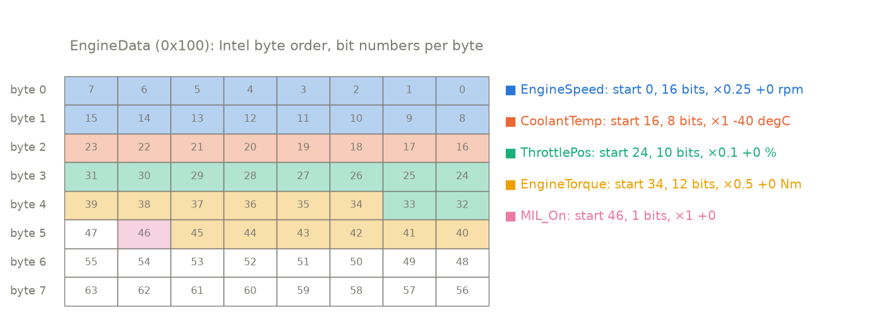

# CAN

## CAN Unpack

`can.unpack` · CAN

Decodes a CAN frame: the input is the 8 data bytes (a vector of width 8), and there is one output per
signal, in physical units (``raw · factor + offset`` from the DBC file).

Intel (little-endian) and Motorola (big-endian) byte order, signed and unsigned signals are supported. The
block can be generated as C code.

### Parameters

| Name | Default | Unit | Description |
|---|---|---|---|
| `dbc_file` | `''` |  | DBC file (relative paths are relative to the model file) |
| `message` | `''` |  | Message name in the DBC file |
| `signals` | `''` |  | Signals to use, comma separated (empty = all, in DBC order) |

*Direct feedthrough:* yes

---

## CAN Pack

`can.pack` · CAN

Encodes a CAN frame: one input per signal (physical units), output = the 8 data bytes (``uint8``).

Values are converted to the raw integer with rounding to nearest and saturated to the bit field, exactly
as the generated C code does. Signals that are not selected are sent as 0.

### Parameters

| Name | Default | Unit | Description |
|---|---|---|---|
| `dbc_file` | `''` |  | DBC file (relative paths are relative to the model file) |
| `message` | `''` |  | Message name in the DBC file |
| `signals` | `''` |  | Signals to use, comma separated (empty = all, in DBC order) |

*Direct feedthrough:* yes

---
