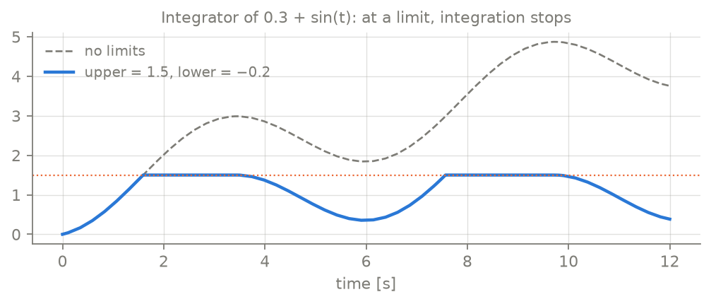
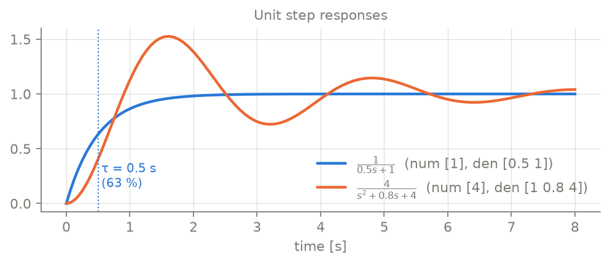

# Continuous

## Integrator

`continuous.integrator` · Continuous

Integrates its input:

$$ y(t) = y_0 + \int_0^t u(\tau)\,d\tau $$

where y₀ is *initial*.

The output is limited to [*lower*, *upper*]. At a limit the integration stops (no wind-up).
A vector *initial* gives a vector integrator; a scalar *initial* expands to the input width.

*external_reset* adds a second input, **reset**. When it fires, the state jumps back to *initial* and the
solver restarts from there: ``rising`` (reset goes from ≤ 0 to > 0), ``falling``, ``either``, or ``level``
(held at *initial* while reset ≠ 0). Variable-step solvers stop exactly at the edge (zero crossing).
Typical use: restart an integral when a mode starts, e.g. the fuel consumed since the engine started.

*initial_source* ``external`` adds an input **x0** (the last port): the initial value comes from that
signal at the start and at every reset, e.g. a temperature that starts at the measured ambient
temperature. *saturation_port* adds a second output: +1 at the upper limit, −1 at the lower limit, 0
in between (e.g. to tell a controller that its integral is saturated).

### Parameters

| Name | Default | Unit | Description |
|---|---|---|---|
| `initial` | `0.0` |  | Initial condition |
| `upper` | inf |  | Upper saturation limit |
| `lower` | -inf |  | Lower saturation limit |
| `external_reset` | `'none'` |  | Add a reset input that sets the state back to the initial value — one of `none`, `rising`, `falling`, `either`, `level` |
| `initial_source` | `'internal'` |  | Where the initial value comes from: the parameter, or an extra input x0 — one of `internal`, `external` |
| `saturation_port` | `False` |  | Add an output: +1 at the upper limit, -1 at the lower |

*Direct feedthrough:* only some inputs (see above)

---

## Derivative

`continuous.derivative` · Continuous

Approximate time derivative of the input.

An exact derivative cannot be simulated robustly, so this block uses the filtered derivative

$$ Y(s) = \frac{s}{\tau s + 1} U(s) $$

with a small *time_constant* τ. Smaller τ is more exact but noisier and stiffer. The filter starts at rest,
so a non-zero input at t = 0 gives an initial spike.

### Parameters

| Name | Default | Unit | Description |
|---|---|---|---|
| `time_constant` | `0.001` | s | Filter time constant τ |

*Direct feedthrough:* yes

---

## Transfer Fcn

`continuous.transfer_function` · Continuous

Continuous SISO transfer function

$$ G(s) = \frac{b_0 s^m + \dots + b_m}{a_0 s^n + \dots + a_n} $$

*numerator* and *denominator* are coefficient lists in descending powers of *s*, e.g. ``[1]`` and ``[0.5, 1]``
for ``1 / (0.5 s + 1)``. The initial state is zero.

### Parameters

| Name | Default | Unit | Description |
|---|---|---|---|
| `numerator` | `[1.0]` |  | Numerator coefficients (descending powers of s) |
| `denominator` | `[1.0, 1.0]` |  | Denominator coefficients (descending powers of s) |

*Direct feedthrough:* depends on parameters

---

## State-Space

`continuous.state_space` · Continuous

Continuous linear state-space system

$$ \dot x = A x + B u, \qquad y = C x + D u $$

The input width must equal the number of columns of *B*; the output width is the number of rows of *C*.

### Parameters

| Name | Default | Unit | Description |
|---|---|---|---|
| `A` | `[[-1.0]]` |  | State matrix (n×n) |
| `B` | `[[1.0]]` |  | Input matrix (n×m) |
| `C` | `[[1.0]]` |  | Output matrix (p×n) |
| `D` | `[[0.0]]` |  | Feedthrough matrix (p×m) |
| `initial` | `0.0` |  | Initial state (scalar or n-vector) |

*Direct feedthrough:* depends on parameters

---
