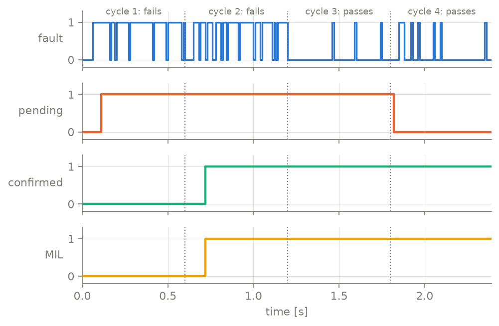

# Diagnostics

## Diagnostic Monitor

`diagnostics.monitor` · Diagnostics

A diagnostic monitor with a trouble code (DTC), like the diagnostic event manager of an engine ECU.

Input **fault** is the raw test result of a monitor (≥ 0.5 = the test failed this sample), e.g.
``rpm_variation > limit`` for a misfire monitor. It is **debounced** with a counter, so a short glitch does
not set a code:

$$ c_k = \begin{cases} \min(c_{k-1} + \mathrm{fail\_step},\ T) & \text{fault} \\ \max(c_{k-1} - \mathrm{pass\_step},\ -T) & \text{no fault} \end{cases} $$

The test has **failed** when the counter reaches *T* (*threshold*) and **passed** when it reaches −*T*.
Like OBD-II, the code is then handled over **operation cycles** (drive cycles):

- the first failure makes the code **pending** at once;
- after *confirm_cycles* operation cycles in a row with a failure (2: "two-trip" detection) it is
  **confirmed**, and the **MIL** (check-engine lamp) comes on if *mil* is set;
- after *heal_cycles* cycles in a row that passed without failure, the MIL goes off again (the code stays
  stored as confirmed, so a workshop can still read it); a cycle without failure also clears *pending*.

Optional inputs (parameters): **enable** (the test conditions are met, e.g. engine warm; the counter
holds while it is 0), **cycle** (a rising edge starts a new operation cycle, e.g. key on), and **clear**
(a rising edge clears the code like OBD mode 04: also the readiness).

Outputs: **mil**, **pending**, **confirmed**, **ready** (the monitor has completed, passed or failed,
since the code was last cleared: the OBD *readiness* of this monitor) and **status**: the UDS status
byte (bit 0 test failed, 1 failed this cycle, 2 pending, 3 confirmed, 4 not completed since clear,
5 failed since clear, 6 not completed this cycle, 7 warning indicator). Outputs change one sample after
the input that causes them. Runs at its sample time.

### Parameters

| Name | Default | Unit | Description |
|---|---|---|---|
| `dtc` | `'P0300'` |  | Trouble code, e.g. P0171 (system too lean) |
| `threshold` | `10.0` |  | Debounce threshold T: failed at +T, passed at -T |
| `fail_step` | `1.0` |  | Counter step up for each failed sample |
| `pass_step` | `1.0` |  | Counter step down for each passed sample |
| `jump_down` | `True` |  | A failure after passing restarts counting from 0 |
| `confirm_cycles` | `2` |  | Operation cycles in a row with a failure to confirm |
| `heal_cycles` | `3` |  | Passed cycles in a row before the MIL goes off |
| `mil` | `True` |  | A confirmed code switches the MIL on |
| `enable_input` | `False` |  | Add an input: the test conditions are met |
| `cycle_input` | `False` |  | Add an input: a rising edge starts a new operation cycle |
| `clear_input` | `False` |  | Add an input: a rising edge clears the code (mode 04) |
| `sample_time` | `0.01` | s | Sample period |

*Direct feedthrough:* no

---

## OBD Responder

`diagnostics.obd_responder` · Diagnostics

Makes the model answer OBD-II requests like a car's engine ECU, while the simulation runs.

Its inputs are the values of the PIDs in *pids* (e.g. ``rpm, speed, coolant_temp``; see
``python -m nervus.obd pids``), then the status bytes of the trouble codes in *dtcs* (wire the **status**
output of a Diagnostic Monitor to each). Every sample they are published to the simulated ECU named
*ecu*, which answers requests from a diagnostic tool:

- mode 01: the PIDs, and PID 01 with the MIL and the number of confirmed codes;
- modes 03 / 07 / 0A: confirmed, pending and permanent codes;
- mode 04 (clear codes): the output **clear** is 1 for one sample; wire it to the *clear* input of the
  Diagnostic Monitors so the model really clears them;
- mode 09: the VIN.

Run the model with ``python -m nervus.obd simulate model.nervus``: it runs in real time and offers the ECU
as an ELM327 adapter on a serial port (a pseudo-terminal) for any OBD program, or on a CAN bus. This block is
part of the test setup: it has no C code.

### Parameters

| Name | Default | Unit | Description |
|---|---|---|---|
| `ecu` | `'ecu'` |  | Name of the simulated ECU |
| `pids` | `'rpm, speed, coolant_temp'` |  | PIDs to report, one input each |
| `dtcs` | `''` |  | Trouble codes, one status input each (from Diagnostic Monitors) |
| `sample_time` | `0.1` | s | How often the ECU's values are updated |

*Direct feedthrough:* no

---
