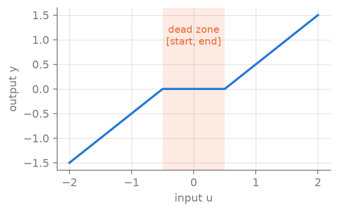
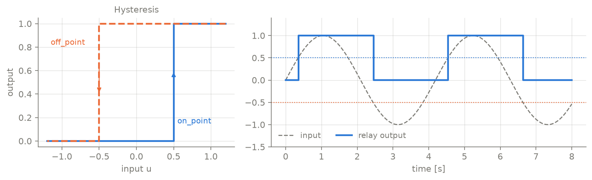
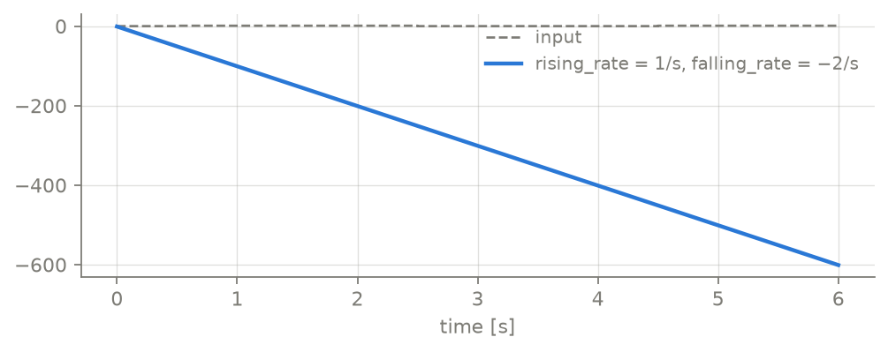
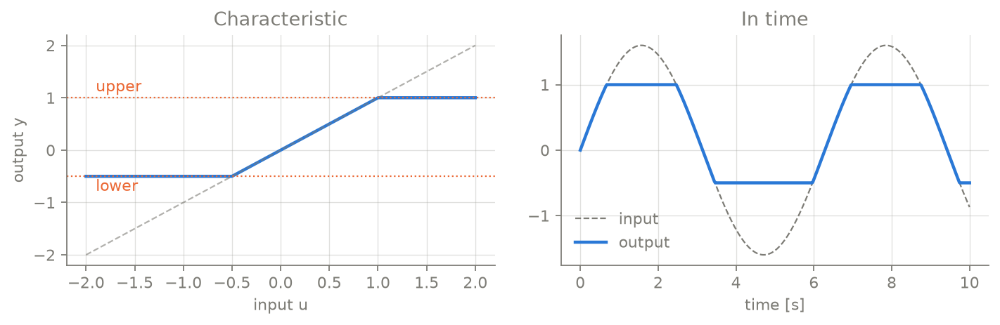

# Discontinuities

## Dead Zone

`discontinuities.dead_zone` · Discontinuities

Zero output inside the dead zone [*start*, *end*]; outside, the input shifted by the zone edge.

$$ y = \begin{cases} u - \mathrm{end} & \text{if } u > \mathrm{end} \\ 0 & \text{if } \mathrm{start} \leq u \leq \mathrm{end} \\ u - \mathrm{start} & \text{if } u < \mathrm{start} \end{cases} $$

Typical use: ignore small pedal or sensor noise around zero.

### Parameters

| Name | Default | Unit | Description |
|---|---|---|---|
| `start` | `-0.5` |  | Lower edge of the dead zone |
| `end` | `0.5` |  | Upper edge of the dead zone |

*Direct feedthrough:* yes

---

## Quantizer

`discontinuities.quantizer` · Discontinuities

Rounds the input to a multiple of *interval*, like an ADC or a fixed-resolution sensor.

$$ y = q \cdot \mathrm{round}(u / q) $$

### Parameters

| Name | Default | Unit | Description |
|---|---|---|---|
| `interval` | `0.5` |  | Quantization interval q |

*Direct feedthrough:* yes

---

## Relay

`discontinuities.relay` · Discontinuities

Switch with hysteresis: turns **on** when the input rises to *on_point* and **off** when it falls to
*off_point*. In between it keeps its previous state.

$$ s[k] = \begin{cases} 1 & \text{if } u[k] \geq \mathrm{on\_point} \\ 0 & \text{if } u[k] \leq \mathrm{off\_point} \\ s[k-1] & \text{otherwise} \end{cases} $$

The output is *on_value* when $s = 1$ and *off_value* when $s = 0$. Use it for thermostats, fan control or
any on/off decision that must not chatter. The relay is evaluated at its sample time, so it needs a
discrete rate (set *sample_time*, or drive it from a discrete block).

### Parameters

| Name | Default | Unit | Description |
|---|---|---|---|
| `on_point` | `1.0` |  | Switch on when u >= on_point |
| `off_point` | `0.0` |  | Switch off when u <= off_point |
| `on_value` | `1.0` |  | Output when on |
| `off_value` | `0.0` |  | Output when off |
| `initial_state` | `'off'` |  | State before the first sample — one of `off`, `on` |
| `sample_time` | -1 (inherited) | s | Sample period (-1 = inherit) |

*Direct feedthrough:* yes

---

## Rate Limiter

`discontinuities.rate_limiter` · Discontinuities

Limits how fast the signal may change, e.g. torque or throttle ramps for drivability.

$$ y[k] = \min\left(\max\left(u[k],\ y[k-1] + R_f T\right),\ y[k-1] + R_r T\right) $$

with rising rate $R_r > 0$ and falling rate $R_f < 0$ in units per second, and sample period $T$.

### Parameters

| Name | Default | Unit | Description |
|---|---|---|---|
| `rising_rate` | `1.0` | 1/s | Maximum increase per second |
| `falling_rate` | `-1.0` | 1/s | Maximum decrease per second (negative) |
| `initial` | `0.0` |  | Output before the first sample |
| `sample_time` | -1 (inherited) | s | Sample period (-1 = inherit) |

*Direct feedthrough:* yes

---

## Saturation

`math.saturation` · Discontinuities

Limits the input to the range [*lower*, *upper*]:

$$ y = \min(\max(u, \mathrm{lower}), \mathrm{upper}) $$

### Parameters

| Name | Default | Unit | Description |
|---|---|---|---|
| `upper` | `0.5` |  | Upper limit |
| `lower` | `-0.5` |  | Lower limit |

*Direct feedthrough:* yes

---
