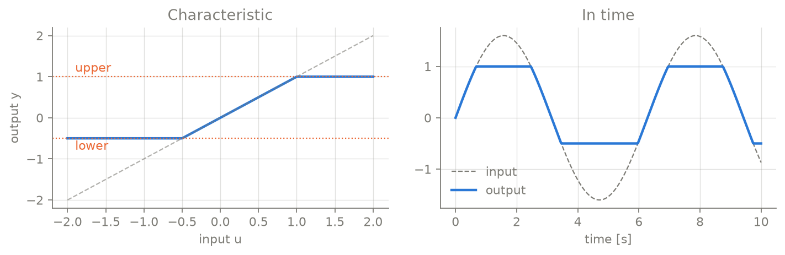

# Discontinuities

## Saturation

`math.saturation` · Discontinuities

Limits the input to the range [*lower*, *upper*]:

$$ y = \min(\max(u, \mathrm{lower}), \mathrm{upper}) $$

### Parameters

| Name | Default | Unit | Description |
|---|---|---|---|
| `upper` | `0.5` |  | Upper limit |
| `lower` | `-0.5` |  | Lower limit |

*Direct feedthrough:* yes

---
