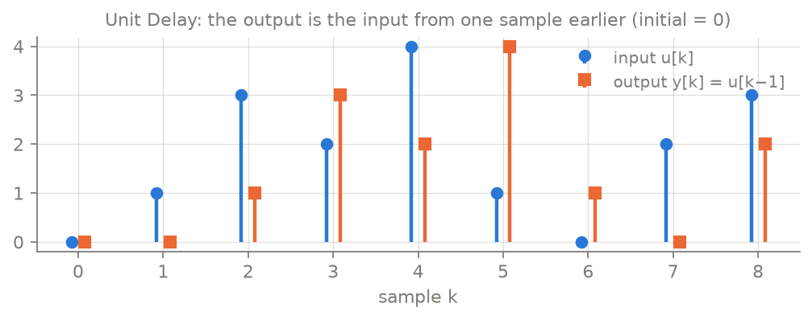
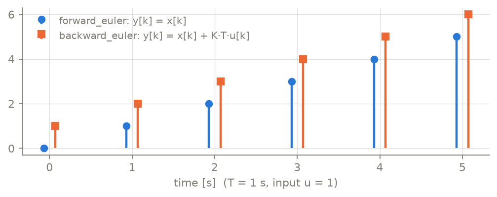
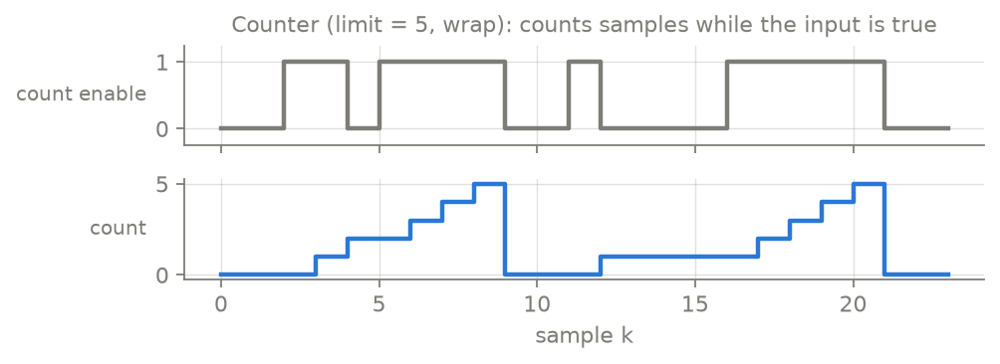
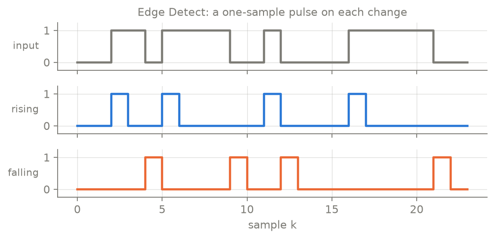
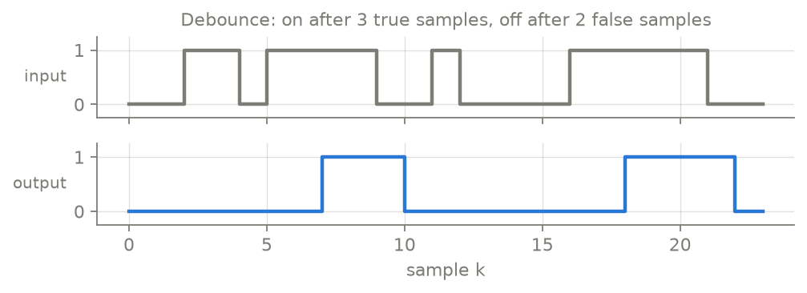
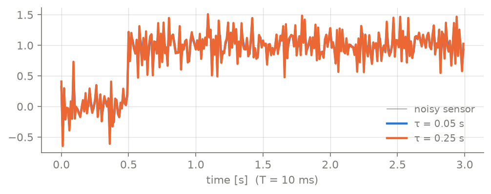

# Discrete

## Unit Delay

`discrete.unit_delay` · Discrete

Delays its input by one sample period:

$$ y[k] = u[k-1], \qquad y[0] = \mathrm{initial} $$

Like an Integrator in continuous time, a Unit Delay breaks algebraic loops in discrete-time feedback.

### Parameters

| Name | Default | Unit | Description |
|---|---|---|---|
| `initial` | `0.0` |  | Initial output |
| `sample_time` | -1 (inherited) | s | Sample period (-1 = inherit from input) |

*Direct feedthrough:* no

---

## Zero-Order Hold

`discrete.zero_order_hold` · Discrete

Samples its input every *sample_time* seconds and holds the value until the next sample:

$$ y(t) = u(kT) \quad \mathrm{for}\ kT \leq t < (k+1)T $$

This is how a continuous signal (e.g. a sensor) enters a discrete controller.

### Parameters

| Name | Default | Unit | Description |
|---|---|---|---|
| `sample_time` | `1.0` | s | Sample period (-1 = inherit from input) |

*Direct feedthrough:* yes

---

## Discrete-Time Integrator

`discrete.integrator` · Discrete

Discrete-time integrator (accumulator).

``forward_euler`` (no direct feedthrough):

$$ y[k] = x[k], \qquad x[k+1] = x[k] + K\,T\,u[k] $$

``backward_euler``:

$$ y[k] = x[k] + K\,T\,u[k], \qquad x[k+1] = y[k] $$

The state is limited to [*lower*, *upper*].

### Parameters

| Name | Default | Unit | Description |
|---|---|---|---|
| `gain` | `1.0` |  | Gain K |
| `initial` | `0.0` |  | Initial condition |
| `method` | `'forward_euler'` |  | Integration method — one of `forward_euler`, `backward_euler` |
| `upper` | inf |  | Upper limit |
| `lower` | -inf |  | Lower limit |
| `sample_time` | `1.0` | s | Sample period (-1 = inherit from input) |

*Direct feedthrough:* depends on parameters

---

## Discrete Transfer Fcn

`discrete.transfer_function` · Discrete

Discrete SISO transfer function

$$ H(z) = \frac{b_0 z^m + \dots + b_m}{a_0 z^n + \dots + a_n} $$

Coefficients are in descending powers of *z*. For example ``[1]`` / ``[1, -0.9]`` is a first-order low-pass.

### Parameters

| Name | Default | Unit | Description |
|---|---|---|---|
| `numerator` | `[1.0]` |  | Numerator coefficients (descending powers of z) |
| `denominator` | `[1.0, 0.5]` |  | Denominator coefficients (descending powers of z) |
| `sample_time` | `1.0` | s | Sample period (-1 = inherit from input) |

*Direct feedthrough:* depends on parameters

---

## Integer Delay

`discrete.integer_delay` · Discrete

Delays its input by *delay* samples: ``y[k] = u[k - N]``. The first N outputs are *initial*.

$$ y[k] = u[k-N] $$

Use it to model communication or processing delays, e.g. a CAN message that arrives one 10 ms frame late.

### Parameters

| Name | Default | Unit | Description |
|---|---|---|---|
| `delay` | `2` |  | Number of samples N |
| `initial` | `0.0` |  | Output during the first N samples |
| `sample_time` | -1 (inherited) | s | Sample period (-1 = inherit from input) |

*Direct feedthrough:* no

---

## Counter

`discrete.counter` · Discrete

Counts samples while the input is non-zero (true).

$$ y[k] = c[k], \qquad c[k+1] = \begin{cases} c[k] + 1 & \text{if } u[k] \neq 0 \\ c[k] & \text{otherwise} \end{cases} $$

At *limit* the counter either ``wrap``s to 0 or ``saturate``s (stays at the limit). Connect a Constant 1
for a free-running counter, e.g. to schedule something every N task periods.

### Parameters

| Name | Default | Unit | Description |
|---|---|---|---|
| `limit` | `255.0` |  | Largest value |
| `at_limit` | `'wrap'` |  | What happens at the limit — one of `wrap`, `saturate` |
| `initial` | `0.0` |  | Initial count |
| `sample_time` | -1 (inherited) | s | Sample period (-1 = inherit from input) |

*Direct feedthrough:* no

---

## Edge Detect

`discrete.edge_detect` · Discrete

Outputs 1 for one sample when the (boolean) input changes, otherwise 0.

*direction*: ``rising`` (false → true), ``falling`` (true → false) or ``either``. The input counts as
true when it is non-zero. Typical use: react once when a switch is pressed or a fault appears.

### Parameters

| Name | Default | Unit | Description |
|---|---|---|---|
| `direction` | `'rising'` |  | Which edge — one of `rising`, `falling`, `either` |
| `initial` | `0.0` |  | Previous input before the first sample (0 or 1) |
| `sample_time` | -1 (inherited) | s | Sample period (-1 = inherit from input) |

*Direct feedthrough:* yes

---

## Debounce

`discrete.debounce` · Discrete

Debounces a boolean input: the output turns on only after the input has been true for *on_samples*
consecutive samples, and off after it has been false for *off_samples* samples.

This is how ECUs filter switch bounce and confirm faults before setting a diagnostic trouble code.

### Parameters

| Name | Default | Unit | Description |
|---|---|---|---|
| `on_samples` | `3` |  | Samples the input must be true to switch on |
| `off_samples` | `3` |  | Samples the input must be false to switch off |
| `sample_time` | -1 (inherited) | s | Sample period (-1 = inherit from input) |

*Direct feedthrough:* yes

---

## Discrete Filter (PT1)

`discrete.filter` · Discrete

First-order low-pass filter, the workhorse for smoothing sensor signals in ECU software.

$$ y[k] = y[k-1] + \alpha\,(u[k] - y[k-1]), \qquad \alpha = \frac{T}{\tau + T} $$

with time constant τ and sample period T. Larger τ gives a smoother but slower signal.

### Parameters

| Name | Default | Unit | Description |
|---|---|---|---|
| `time_constant` | `0.1` | s | Filter time constant τ |
| `initial` | `0.0` |  | Initial output |
| `sample_time` | -1 (inherited) | s | Sample period (-1 = inherit from input) |

*Direct feedthrough:* yes

---

## Moving Average

`discrete.moving_average` · Discrete

Average of the last *length* samples (including the current one).

$$ y[k] = \frac{1}{N} \sum_{i=0}^{N-1} u[k-i] $$

Before N samples exist, the missing ones count as *initial*.

### Parameters

| Name | Default | Unit | Description |
|---|---|---|---|
| `length` | `4` |  | Number of samples N |
| `initial` | `0.0` |  | Value of samples before the start |
| `sample_time` | -1 (inherited) | s | Sample period (-1 = inherit from input) |

*Direct feedthrough:* yes

---
