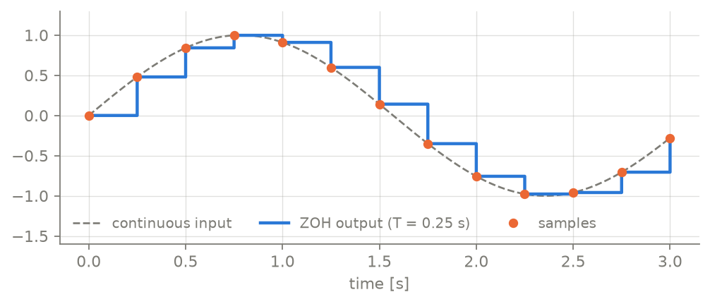

# Discrete

## Unit Delay

`discrete.unit_delay` · Discrete

Delays its input by one sample period:

$$ y[k] = u[k-1], \qquad y[0] = \mathrm{initial} $$

Like an Integrator in continuous time, a Unit Delay breaks algebraic loops in discrete-time feedback.

### Parameters

| Name | Default | Unit | Description |
|---|---|---|---|
| `initial` | `0.0` |  | Initial output |
| `sample_time` | -1 (inherited) | s | Sample period (-1 = inherit from input) |

*Direct feedthrough:* no

---

## Zero-Order Hold

`discrete.zero_order_hold` · Discrete

Samples its input every *sample_time* seconds and holds the value until the next sample:

$$ y(t) = u(kT) \quad \mathrm{for}\ kT \leq t < (k+1)T $$

This is how a continuous signal (e.g. a sensor) enters a discrete controller.

### Parameters

| Name | Default | Unit | Description |
|---|---|---|---|
| `sample_time` | `1.0` | s | Sample period (-1 = inherit from input) |

*Direct feedthrough:* yes

---

## Discrete-Time Integrator

`discrete.integrator` · Discrete

Discrete-time integrator (accumulator).

``forward_euler`` (no direct feedthrough):

$$ y[k] = x[k], \qquad x[k+1] = x[k] + K\,T\,u[k] $$

``backward_euler``:

$$ y[k] = x[k] + K\,T\,u[k], \qquad x[k+1] = y[k] $$

The state is limited to [*lower*, *upper*].

### Parameters

| Name | Default | Unit | Description |
|---|---|---|---|
| `gain` | `1.0` |  | Gain K |
| `initial` | `0.0` |  | Initial condition |
| `method` | `'forward_euler'` |  | Integration method — one of `forward_euler`, `backward_euler` |
| `upper` | inf |  | Upper limit |
| `lower` | -inf |  | Lower limit |
| `sample_time` | `1.0` | s | Sample period (-1 = inherit from input) |

*Direct feedthrough:* depends on parameters

---

## Discrete Transfer Fcn

`discrete.transfer_function` · Discrete

Discrete SISO transfer function

$$ H(z) = \frac{b_0 z^m + \dots + b_m}{a_0 z^n + \dots + a_n} $$

Coefficients are in descending powers of *z*. For example ``[1]`` / ``[1, -0.9]`` is a first-order low-pass.

### Parameters

| Name | Default | Unit | Description |
|---|---|---|---|
| `numerator` | `[1.0]` |  | Numerator coefficients (descending powers of z) |
| `denominator` | `[1.0, 0.5]` |  | Denominator coefficients (descending powers of z) |
| `sample_time` | `1.0` | s | Sample period (-1 = inherit from input) |

*Direct feedthrough:* depends on parameters

---
