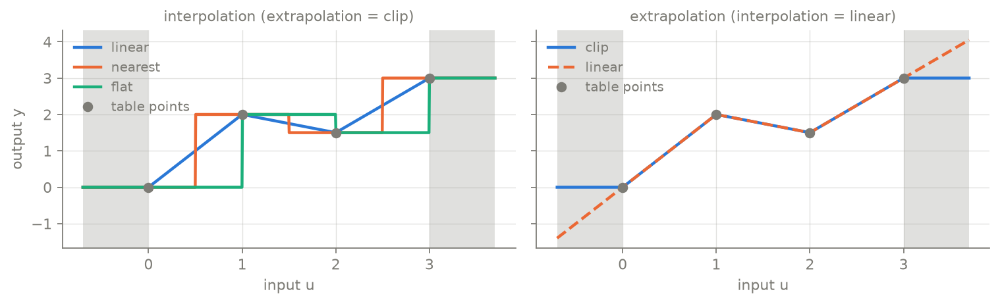

# Lookup Tables

## 1-D Lookup Table

`lookup.table_1d` · Lookup Tables

1-D lookup table (a calibration *curve*): maps the input through a table of points.

For an input between breakpoints $x_i$ and $x_{i+1}$ with linear interpolation:

$$ y = t_i + \frac{u - x_i}{x_{i+1} - x_i}\,(t_{i+1} - t_i) $$

- *interpolation*: ``linear``; ``nearest`` (closest point); ``flat`` (value of the breakpoint at or
  below the input, a staircase).
- *extrapolation*: ``clip`` holds the end values; ``linear`` extends the first/last segment.

Each element of a vector input is looked up separately.

### Parameters

| Name | Default | Unit | Description |
|---|---|---|---|
| `breakpoints` | `[0.0, 1.0, 2.0]` |  | Input values (strictly increasing) |
| `table` | `[0.0, 1.0, 4.0]` |  | Output value at each breakpoint |
| `interpolation` | `'linear'` |  | Between breakpoints — one of `linear`, `nearest`, `flat` |
| `extrapolation` | `'clip'` |  | Outside the breakpoints — one of `clip`, `linear` |

*Direct feedthrough:* yes

---

## 2-D Lookup Table

`lookup.table_2d` · Lookup Tables

2-D lookup table (a calibration *map*), e.g. ignition advance over engine speed and load.

Input 0 selects the **row** (``row_breakpoints``) and input 1 the **column** (``column_breakpoints``).
``table`` has one row per row breakpoint and one column per column breakpoint. With linear interpolation
the result is bilinear between the four surrounding points:

$$ y = (1-f_r)(1-f_c)\,T_{i,j} + (1-f_r) f_c\,T_{i,j+1} + f_r (1-f_c)\,T_{i+1,j} + f_r f_c\,T_{i+1,j+1} $$

where $f_r$ and $f_c$ are the fractions within the row and column intervals. Interpolation and
extrapolation work as in the 1-D table.

### Parameters

| Name | Default | Unit | Description |
|---|---|---|---|
| `row_breakpoints` | `[0.0, 1.0]` |  | Breakpoints for input 0 (rows) |
| `column_breakpoints` | `[0.0, 1.0]` |  | Breakpoints for input 1 (columns) |
| `table` | `[[0.0, 1.0], [1.0, 2.0]]` |  | Table: rows × columns |
| `interpolation` | `'linear'` |  | Between breakpoints — one of `linear`, `nearest` |
| `extrapolation` | `'clip'` |  | Outside the breakpoints — one of `clip`, `linear` |

*Direct feedthrough:* yes

---
