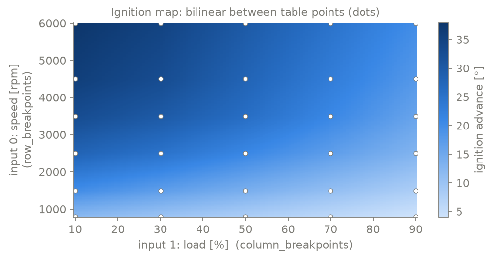
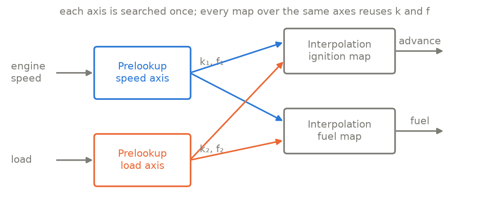

# Lookup Tables

## 1-D Lookup Table

`lookup.table_1d` · Lookup Tables

1-D lookup table (a calibration *curve*): maps the input through a table of points.

For an input between breakpoints $x_i$ and $x_{i+1}$ with linear interpolation:

$$ y = t_i + \frac{u - x_i}{x_{i+1} - x_i}\,(t_{i+1} - t_i) $$

- *interpolation*: ``linear``; ``nearest`` (closest point); ``flat`` (value of the breakpoint at or
  below the input, a staircase).
- *extrapolation*: ``clip`` holds the end values; ``linear`` extends the first/last segment.

Each element of a vector input is looked up separately.

### Parameters

| Name | Default | Unit | Description |
|---|---|---|---|
| `breakpoints` | `[0.0, 1.0, 2.0]` |  | Input values (strictly increasing) |
| `table` | `[0.0, 1.0, 4.0]` |  | Output value at each breakpoint |
| `interpolation` | `'linear'` |  | Between breakpoints — one of `linear`, `nearest`, `flat` |
| `extrapolation` | `'clip'` |  | Outside the breakpoints — one of `clip`, `linear` |
| `output_type` | `'double'` |  | Output data type: inherit, double, single, boolean, int8…uint32, fixdt(signed, bits, fraction) |

*Direct feedthrough:* yes

---

## 2-D Lookup Table

`lookup.table_2d` · Lookup Tables

2-D lookup table (a calibration *map*), e.g. ignition advance over engine speed and load.

Input 0 selects the **row** (``row_breakpoints``) and input 1 the **column** (``column_breakpoints``).
``table`` has one row per row breakpoint and one column per column breakpoint. With linear interpolation
the result is bilinear between the four surrounding points:

$$ y = (1-f_r)(1-f_c)\,T_{i,j} + (1-f_r) f_c\,T_{i,j+1} + f_r (1-f_c)\,T_{i+1,j} + f_r f_c\,T_{i+1,j+1} $$

where $f_r$ and $f_c$ are the fractions within the row and column intervals. Interpolation and
extrapolation work as in the 1-D table.

### Parameters

| Name | Default | Unit | Description |
|---|---|---|---|
| `row_breakpoints` | `[0.0, 1.0]` |  | Breakpoints for input 0 (rows) |
| `column_breakpoints` | `[0.0, 1.0]` |  | Breakpoints for input 1 (columns) |
| `table` | `[[0.0, 1.0], [1.0, 2.0]]` |  | Table: rows × columns |
| `interpolation` | `'linear'` |  | Between breakpoints — one of `linear`, `nearest` |
| `extrapolation` | `'clip'` |  | Outside the breakpoints — one of `clip`, `linear` |
| `output_type` | `'double'` |  | Output data type: inherit, double, single, boolean, int8…uint32, fixdt(signed, bits, fraction) |

*Direct feedthrough:* yes

---

## Prelookup

`lookup.prelookup` · Lookup Tables

Breakpoint search on its own: finds the interval index *k* and the fraction *f* of the input.

For an input between breakpoints $x_k$ and $x_{k+1}$:

$$ f = \frac{u - x_k}{x_{k+1} - x_k} $$

Output 0 is *k* (0-based), output 1 is *f*. Feed both into one or more **Interpolation** blocks. ECUs
calibrate many maps over the same axes (engine speed, load); searching the axis once and sharing the
result saves time on the processor, and the A2L file can declare the axis as a shared axis.

With ``clip`` extrapolation, *f* stays in [0, 1]; with ``linear`` it continues outside.

### Parameters

| Name | Default | Unit | Description |
|---|---|---|---|
| `breakpoints` | `[0.0, 1.0, 2.0]` |  | Axis points (strictly increasing) |
| `extrapolation` | `'clip'` |  | Outside the breakpoints — one of `clip`, `linear` |

*Direct feedthrough:* yes

---

## Interpolation using Prelookup

`lookup.interpolation` · Lookup Tables

Interpolates a 1-D or 2-D *table* at the index and fraction from Prelookup blocks.

Inputs: ``k1, f1`` (1-D) or ``k1, f1, k2, f2`` (2-D, rows then columns). The result is the same as a
1-D/2-D Lookup Table with linear interpolation over the same breakpoints:

$$ y = (1-f_1)(1-f_2)\,T_{k_1,k_2} + (1-f_1) f_2\,T_{k_1,k_2+1} + f_1 (1-f_2)\,T_{k_1+1,k_2} + f_1 f_2\,T_{k_1+1,k_2+1} $$

### Parameters

| Name | Default | Unit | Description |
|---|---|---|---|
| `dimensions` | `1` |  | Number of table dimensions (1 or 2) |
| `table` | `[0.0, 1.0, 4.0]` |  | Table values (1-D: one per breakpoint; 2-D: rows × columns) |
| `output_type` | `'double'` |  | Output data type: inherit, double, single, boolean, int8…uint32, fixdt(signed, bits, fraction) |

*Direct feedthrough:* yes

---
