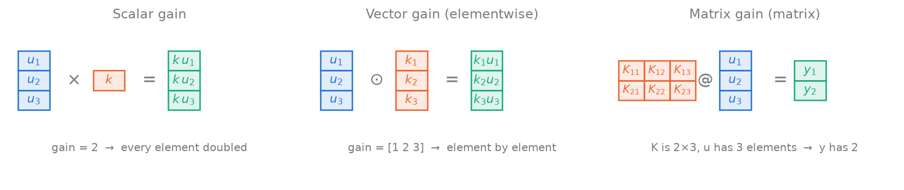
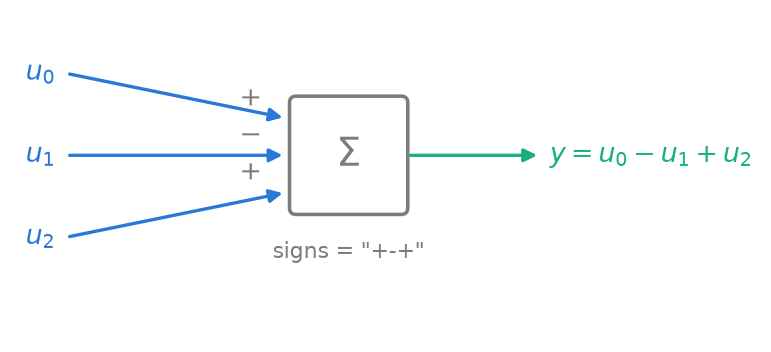

# Math Operations

## Gain

`math.gain` · Math Operations

Multiplies the input by a constant.

With *multiplication* = ``elementwise`` each element is multiplied by the matching gain element (a scalar
gain multiplies every element). With ``matrix`` the output is the matrix product of the gain matrix *K* and
the input vector:

$$ y_i = k_i\,u_i \qquad\qquad y = K\,u $$

### Parameters

| Name | Default | Unit | Description |
|---|---|---|---|
| `gain` | `1.0` |  | Gain value (scalar, vector or matrix) |
| `multiplication` | `'elementwise'` |  | Multiplication — one of `elementwise`, `matrix` |

*Direct feedthrough:* yes

---

## Sum

`math.sum` · Math Operations

Adds and subtracts its inputs.

*signs* holds one ``+`` or ``-`` per input, e.g. ``"+-"`` gives ``u0 - u1``. ``|`` characters are ignored
(for spacing, as in Simulink).

$$ y = \sum_i s_i\,u_i, \quad s_i \in \{+1, -1\} $$

### Parameters

| Name | Default | Unit | Description |
|---|---|---|---|
| `signs` | `'++'` |  | One + or - per input |

*Direct feedthrough:* yes

---

## Product

`math.product` · Math Operations

Multiplies and divides its inputs elementwise.

*ops* holds one ``*`` or ``/`` per input, e.g. ``"*/"`` gives ``u0 / u1``.

$$ y = \prod_i u_i^{\,p_i}, \quad p_i \in \{+1, -1\} $$

### Parameters

| Name | Default | Unit | Description |
|---|---|---|---|
| `ops` | `'**'` |  | One * or / per input |

*Direct feedthrough:* yes

---

## Abs

`math.abs` · Math Operations

Absolute value, ``|u|``.

*Direct feedthrough:* yes

---

## Math Function

`math.function` · Math Operations

Applies a mathematical function elementwise: exp, log, sqrt, square, sin, cos, tanh, sign, ...

### Parameters

| Name | Default | Unit | Description |
|---|---|---|---|
| `function` | `'exp'` |  | Function — one of `exp`, `log`, `log10`, `sqrt`, `square`, `reciprocal`, `sin`, `cos`, `tan`, `asin`, `acos`, `atan`, `sinh`, `cosh`, `tanh`, `sign`, `floor`, `ceil`, `round` |

*Direct feedthrough:* yes

---
