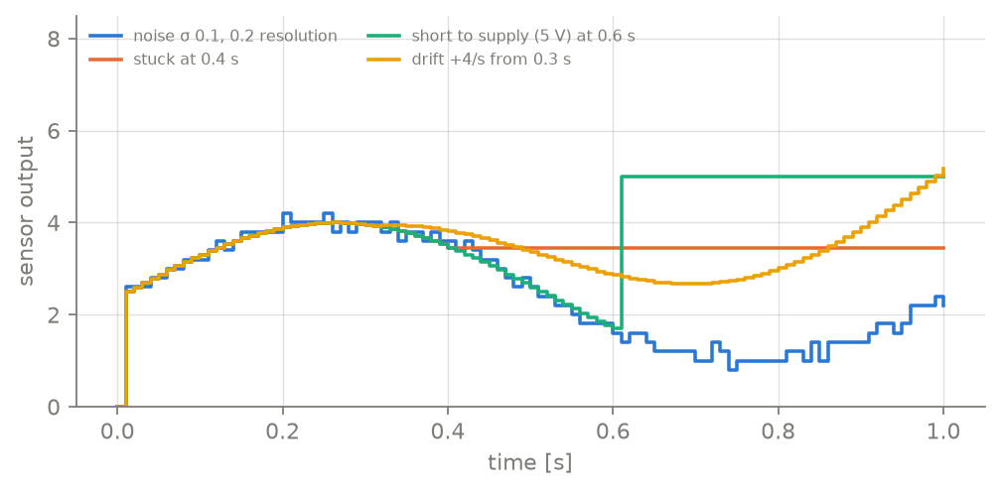

# Sensors & Actuators

## Sensor Model

`sensors.sensor` · Sensors & Actuators

A real sensor between the physical value and the ECU's input, sampled every *sample_time*:

$$ y = \mathrm{quantize}(\mathrm{clip}(g\,u(t - d) + o + \sigma\,n,\ y_{min},\ y_{max})) $$

with gain error *g* (1 = exact), offset *o*, white noise of standard deviation *σ* (reproducible: the same
every run for the same *seed*), a delay *d* of whole samples (filtering, a slow bus), limits of the measuring
range and the *resolution* of the A/D converter (0 = none).

*fault* injects a failure from *fault_time*: ``stuck`` (the last good value), ``open_circuit`` (the lower
rail, *y_min*), ``short_to_supply`` (the upper rail, *y_max*), ``drift`` (an offset growing by *drift_rate*
per second). Use it to test the ECU's plausibility checks and diagnostic monitors.

### Parameters

| Name | Default | Unit | Description |
|---|---|---|---|
| `gain` | `1.0` |  | Gain (1 = exact) |
| `offset` | `0.0` |  | Offset error |
| `noise` | `0.0` |  | Noise standard deviation |
| `delay` | `0` |  | Delay in samples |
| `resolution` | `0.0` |  | Quantization step (0 = none) |
| `y_min` | -inf |  | Lower end of the measuring range |
| `y_max` | inf |  | Upper end of the measuring range |
| `fault` | `'none'` |  | Injected fault — one of `none`, `stuck`, `open_circuit`, `short_to_supply`, `drift` |
| `fault_time` | `0.0` | s | When the fault starts |
| `drift_rate` | `1.0` | 1/s | Offset growth for the drift fault |
| `seed` | `1` |  | Noise stream (change it for an independent sensor) |
| `sample_time` | `0.01` | s | Sample period |

*Direct feedthrough:* no

---

## Actuator Model

`sensors.actuator` · Sensors & Actuators

A real actuator between the ECU's command and the physical effect, sampled every *sample_time*: a delay
of whole samples (driver stage, bus), a rate limit (it cannot move faster than *rate* per second) and the
limits of its range. *fault* ``stuck`` freezes it at its position from *fault_time* (a sticking valve).

### Parameters

| Name | Default | Unit | Description |
|---|---|---|---|
| `delay` | `0` |  | Delay in samples |
| `rate` | inf |  | Largest change per second |
| `y_min` | -inf |  | Lower limit |
| `y_max` | inf |  | Upper limit |
| `initial` | `0.0` |  | Initial position |
| `fault` | `'none'` |  | Injected fault — one of `none`, `stuck` |
| `fault_time` | `0.0` | s | When the fault starts |
| `sample_time` | `0.01` | s | Sample period |

*Direct feedthrough:* no

---
