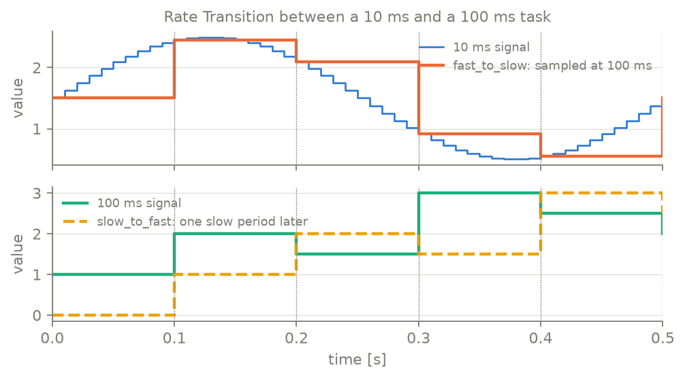
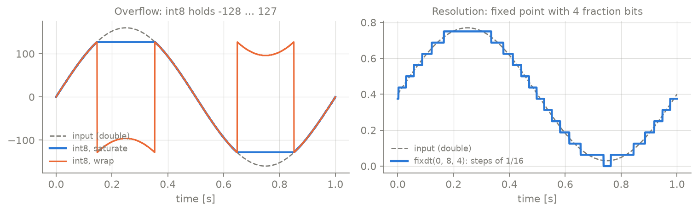

# Signal Attributes

## Rate Transition

`discrete.rate_transition` · Signal Attributes

Passes a signal between two rates (two ECU tasks) in a way that is deterministic on an RTOS.

Set *sample_time* to the **slower** of the two rates. For ``slow_to_fast``, also set *output_sample_time* to
the fast rate, so that the blocks after it inherit the fast rate.

- ``fast_to_slow``: the slow task gets the fast signal sampled at its own start:
  $y = u$ at every slow sample (like a Zero-Order Hold).
- ``slow_to_fast``: the fast task gets the slow signal **one slow period late**:
  $y[k] = u[k-1]$ at the slow rate (like a Unit Delay), held in between.

Why the delay? On an ECU the fast task interrupts the slow one. If the fast task read the slow task's output
directly, it would sometimes see the old and sometimes the new value, depending on timing. With the delay it
always sees the value the slow task finished one period ago, in the simulation and on the target.
C code generated with one function per task (``generate_c(..., tasks=True)``) requires a Rate Transition on
every signal that crosses between rates.

### Parameters

| Name | Default | Unit | Description |
|---|---|---|---|
| `direction` | `'fast_to_slow'` |  | From a faster to a slower rate, or from slower to faster — one of `fast_to_slow`, `slow_to_fast` |
| `initial` | `0.0` |  | Output before the first slow sample has arrived (slow_to_fast) |
| `sample_time` | `0.1` | s | Sample period (-1 = inherit from input) |
| `output_sample_time` | -1 (inherited) | s | slow_to_fast: the fast rate that the blocks after it inherit (-1 = the sample time) |

*Direct feedthrough:* depends on parameters

---

## Data Type Conversion

`routing.datatype_conversion` · Signal Attributes

Converts the input to another data type, e.g. a sensor value to ``int16`` or a controller output to
fixed point.

The real-world value is kept as well as the type allows:

$$ Q = \mathrm{round}\left(\frac{u - \mathrm{bias}}{\mathrm{slope}}\right), \qquad y = \mathrm{slope} \cdot Q + \mathrm{bias} $$

*rounding*: ``nearest`` (half away from zero), ``floor``, ``ceil`` or ``zero`` (truncate). *overflow*:
``saturate`` limits to the type's range; ``wrap`` wraps around like C integer arithmetic. For example
``int8`` turns 3.6 into 4, and 200 into 127 (saturate) or -56 (wrap).

### Parameters

| Name | Default | Unit | Description |
|---|---|---|---|
| `output_type` | `'int16'` |  | Output data type: inherit, double, single, boolean, int8…uint32, fixdt(signed, bits, fraction) |
| `rounding` | `'nearest'` |  | Rounding — one of `nearest`, `floor`, `ceil`, `zero` |
| `overflow` | `'saturate'` |  | Out-of-range values — one of `saturate`, `wrap` |

*Direct feedthrough:* yes

---
