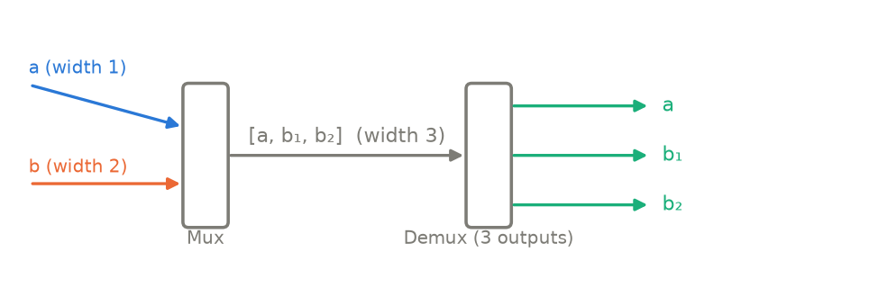
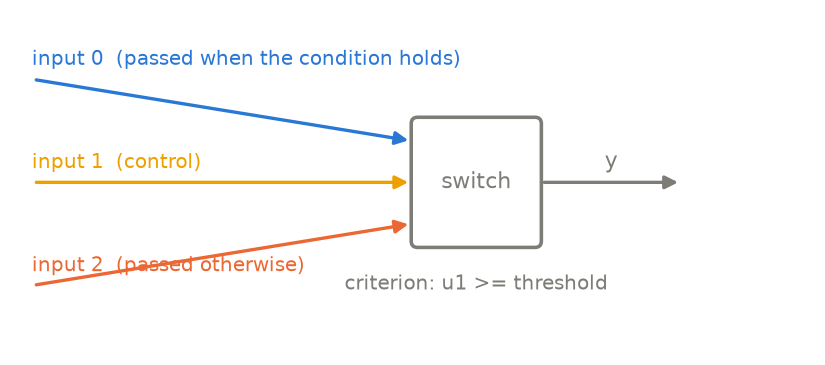

# Signal Routing

## Mux

`routing.mux` · Signal Routing

Combines its inputs into one vector signal, in port order.

### Parameters

| Name | Default | Unit | Description |
|---|---|---|---|
| `num_inputs` | `2` |  | Number of inputs |

*Direct feedthrough:* yes

---

## Demux

`routing.demux` · Signal Routing

Splits a vector signal into *num_outputs* equally sized parts.

### Parameters

| Name | Default | Unit | Description |
|---|---|---|---|
| `num_outputs` | `2` |  | Number of outputs |

*Direct feedthrough:* yes

---

## Switch

`routing.switch` · Signal Routing

Passes input 0 when the control input (input 1) satisfies *criterion*, otherwise input 2:

$$ y = \begin{cases} u_0 & \text{if } u_1 \geq \mathrm{threshold} \\ u_2 & \text{otherwise} \end{cases} $$

Criteria: ``u1 >= threshold``, ``u1 > threshold`` or ``u1 != 0``. The control input must be scalar.

### Parameters

| Name | Default | Unit | Description |
|---|---|---|---|
| `criterion` | `'u1 >= threshold'` |  | Condition on the control input — one of `u1 >= threshold`, `u1 > threshold`, `u1 != 0` |
| `threshold` | `0.0` |  | Threshold |

*Direct feedthrough:* yes

---
