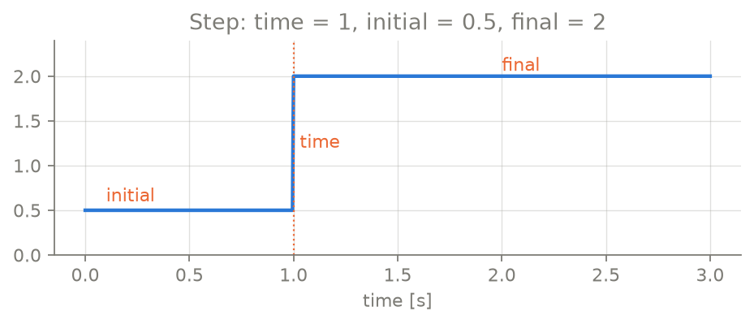
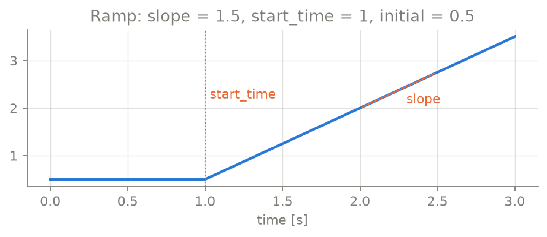
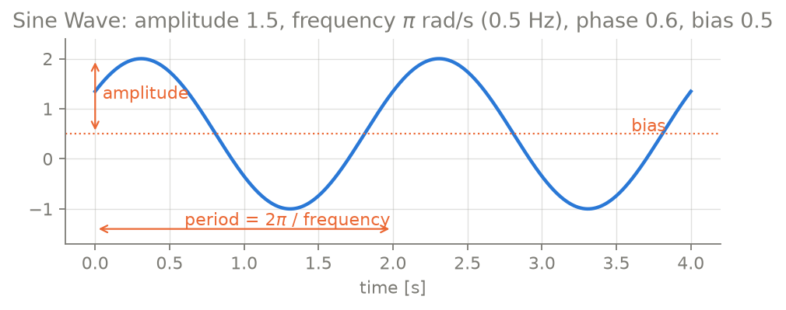
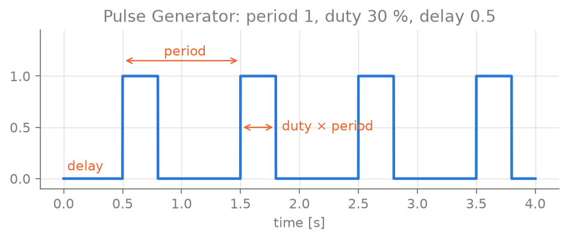
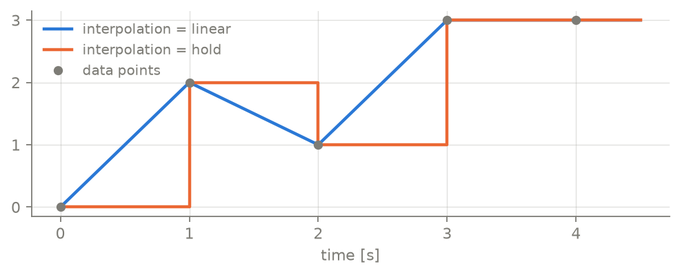
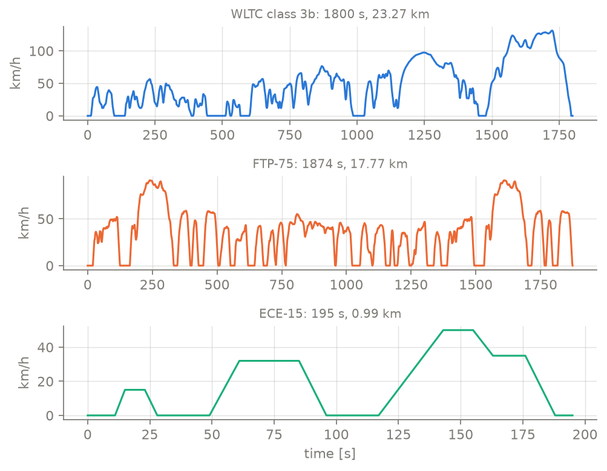

# Sources

## Signal Builder

`sources.signal_builder` · Sources

Test signals drawn as lines: one output per signal, several **groups** (scenarios) to choose from.

Double-click the block to draw the signals in the **signal editor**: drag a point, double-click to add one,
select it and press Delete to remove it. The *group* chooses the scenario the simulation uses, e.g. a tip-in
or a panic stop.

The signals are stored as text in *definition*, one line per signal: ``pedal: 0 0, 1 0, 1 80, 10 80`` (pairs of
time and value). Two points at the same time make a jump; after the last point the value is held. Variable-step
solvers stop exactly at every point, so jumps are sharp.

### Parameters

| Name | Default | Unit | Description |
|---|---|---|---|
| `definition` | *(code)* |  | The signals: groups of 'name: t v, t v, ...' lines |
| `group` | `''` |  | The group (scenario) to play; empty = the first |

*Direct feedthrough:* yes · no inputs

---

## Constant

`sources.constant` · Sources

Outputs a constant value (scalar or vector).

**Parameters**

- *value*: the output value.

### Parameters

| Name | Default | Unit | Description |
|---|---|---|---|
| `value` | `1.0` |  | Output value |
| `sample_time` | inf | s | inf = constant |
| `output_type` | `'double'` |  | Output data type: inherit, double, single, boolean, int8…uint32, fixdt(signed, bits, fraction) |

*Direct feedthrough:* yes · no inputs

---

## Step

`sources.step` · Sources

Steps from *initial* to *final* at *time*.

$$ y(t) = \begin{cases} \text{initial} & \text{if } t < \text{time} \\
\text{final} & \text{if } t \ge \text{time} \end{cases} $$

### Parameters

| Name | Default | Unit | Description |
|---|---|---|---|
| `time` | `1.0` | s | Step time |
| `initial` | `0.0` |  | Value before the step |
| `final` | `1.0` |  | Value after the step |
| `sample_time` | `0.0` | s | 0 = continuous, > 0 = discrete period |

*Direct feedthrough:* yes · no inputs

---

## Ramp

`sources.ramp` · Sources

A ramp starting at *start_time*:

$$ y(t) = \mathrm{initial} + \mathrm{slope} \cdot \max(0,\ t - t_\mathrm{start}) $$

### Parameters

| Name | Default | Unit | Description |
|---|---|---|---|
| `slope` | `1.0` | 1/s | Slope |
| `start_time` | `0.0` | s | Time the ramp starts |
| `initial` | `0.0` |  | Output before the ramp starts |
| `sample_time` | `0.0` | s | 0 = continuous, > 0 = discrete period |

*Direct feedthrough:* yes · no inputs

---

## Sine Wave

`sources.sine` · Sources

Sine wave:

$$ y(t) = A \sin(\omega t + \varphi) + b $$

with amplitude *A*, angular *frequency* ω, *phase* φ and *bias* b.

*frequency* is in rad/s, as in Simulink. For a frequency *f* in Hz use ``2*pi*f``.

### Parameters

| Name | Default | Unit | Description |
|---|---|---|---|
| `amplitude` | `1.0` |  | Amplitude |
| `frequency` | `1.0` | rad/s | Angular frequency |
| `phase` | `0.0` | rad | Phase |
| `bias` | `0.0` |  | Offset added to the wave |
| `sample_time` | `0.0` | s | 0 = continuous, > 0 = discrete period |

*Direct feedthrough:* yes · no inputs

---

## Pulse Generator

`sources.pulse` · Sources

Square pulse train. High (*amplitude*) for *duty* percent of each *period*, otherwise 0.
The first pulse starts at *delay*.

### Parameters

| Name | Default | Unit | Description |
|---|---|---|---|
| `amplitude` | `1.0` |  | Pulse height |
| `period` | `1.0` | s | Period |
| `duty` | `50.0` | % | Pulse width as % of the period |
| `delay` | `0.0` | s | Phase delay |
| `sample_time` | `0.0` | s | 0 = continuous, > 0 = discrete period |

*Direct feedthrough:* yes · no inputs

---

## Clock

`sources.clock` · Sources

Outputs the simulation time *t*.

*Direct feedthrough:* yes · no inputs

---

## From Workspace

`sources.from_workspace` · Sources

Plays back recorded data.

Give either *time* and *data* arrays (data has one row per time point, one column per signal element), or a
*csv_file* whose first column is time and remaining columns are data (a header row is skipped automatically).

*interpolation*: ``linear`` interpolates between points; ``hold`` keeps the last value (zero-order hold).
Outside the time range the first/last value is held.

### Parameters

| Name | Default | Unit | Description |
|---|---|---|---|
| `time` | `[0.0, 1.0]` | s | Time points (increasing) |
| `data` | `[0.0, 1.0]` |  | Values: one row per time point |
| `csv_file` | `''` |  | Optional CSV file (overrides time/data) |
| `interpolation` | `'linear'` |  | Interpolation — one of `linear`, `hold` |
| `sample_time` | `0.0` | s | 0 = continuous, > 0 = discrete period |

*Direct feedthrough:* yes · no inputs

---

## Ground

`sources.ground` · Sources

Outputs zero. Use it to connect an input you do not need, instead of leaving it unconnected.

*Direct feedthrough:* yes · no inputs

---

## Drive Cycle

`sources.drive_cycle` · Sources

A standard drive cycle as a speed profile (the target for a driver model):

- ``wltc3b``: WLTC class 3b (WLTP, the European type approval since 2017), 1800 s, 23.3 km, up to 131 km/h;
- ``ftp75``: FTP-75, the US city cycle, 1874 s, 17.8 km;
- ``ece15``: ECE-15, the urban part of the old NEDC, 195 s, 1 km;
- ``csv_file``: your own: two columns, time [s] and speed [km/h].

Output 0 is the speed (km/h or m/s, *unit*), output 1 the acceleration [m/s²] (the slope of the profile,
useful as a feed-forward for a driver model). After the end of the cycle the speed stays 0. The WLTC and
FTP-75 tables are the official second-by-second values.

### Parameters

| Name | Default | Unit | Description |
|---|---|---|---|
| `cycle` | `'wltc3b'` |  | Cycle — one of `wltc3b`, `ftp75`, `ece15`, `csv_file` |
| `csv_file` | `''` |  | CSV file (time s, speed km/h) for cycle = csv_file |
| `unit` | `'km/h'` |  | Speed unit of the output — one of `km/h`, `m/s` |
| `sample_time` | `0.0` | s | 0 = continuous, > 0 = discrete period |

*Direct feedthrough:* yes · no inputs

---
