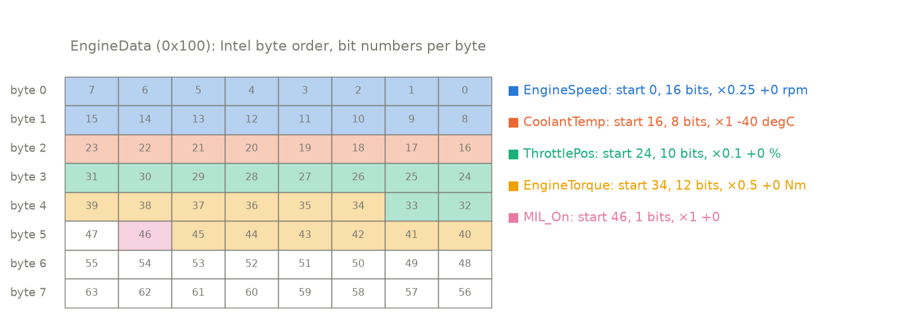
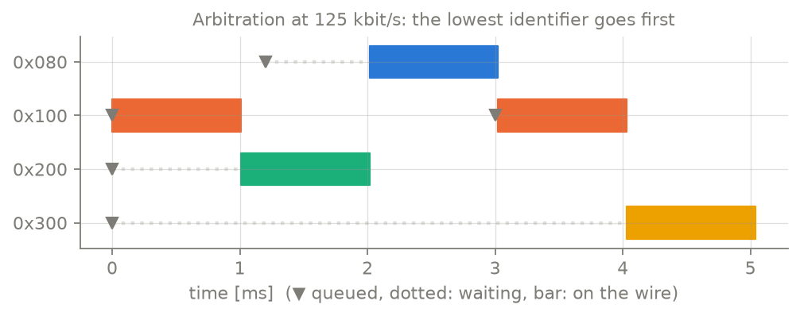

# CAN communication

ECUs exchange signals over **CAN**. Which bits of a frame carry which signal, and how to convert them to
physical units, is described in a **DBC** file. Nervus reads DBC files (`uv sync --extra can`). Two blocks in
the **CAN** library convert between signals and bytes; the others simulate whole
[CAN buses](#simulated-can-buses):

| Block | Input | Output |
|---|---|---|
| **CAN Unpack** | the frame's 8 data bytes (a vector of width 8) | one output per signal, in physical units |
| **CAN Pack** | one input per signal, in physical units | the 8 data bytes (`uint8`) |

Set *dbc_file* (relative paths are relative to the model file), choose the *message* from the drop-down, and
optionally list the *signals* to use (empty = all, in DBC order).



## Conversion

Each signal occupies *length* bits starting at *start bit*:

$$ \mathrm{physical} = \mathrm{raw} \cdot \mathrm{factor} + \mathrm{offset} $$

- **Intel** byte order (`@1` in the DBC): the start bit is the signal's least significant bit; bytes are in
  little-endian order.
- **Motorola** byte order (`@0`): the start bit is the signal's most significant bit; bytes are in
  big-endian order.
- Signed signals (`-`) are two's complement.

**CAN Pack** rounds to the nearest raw value (half away from zero) and saturates to the bit field, so an
out-of-range value is sent as the closest representable one.

## Bit-exact and generatable

Packing and unpacking use the same 64-bit integer arithmetic in the simulation and in the generated C code.
The test suite checks the decoding against the `cantools` library for random frames, and checks the
generated C against the simulation with zero tolerance. A typical use is an ECU subsystem with a CAN Unpack
at its inputs and a CAN Pack at its outputs; the generated `step()` function then reads and writes raw frames.

## Simulated CAN buses

Pack and Unpack turn signals into bytes; the blocks below put those bytes on a **simulated bus**, so several
ECUs can talk to each other with realistic timing, and faults can be injected.

| Block | What it does |
|---|---|
| **CAN Transmit** | sends a message: *periodic* (its *sample_time*; 0 = the DBC's `GenMsgCycleTime`), *on_change* or *on_trigger*; signals or raw bytes (*payload*); fault injection |
| **CAN Receive** | the last received frame: one output per signal (or the 8 bytes), then **new** (a frame arrived this sample) and **age** (seconds since the last frame) |
| **CAN Bus** | bit rate of a bus, its **load** as an output, and optionally a **real interface** |
| **CAN Rest Bus** | sends every message of the ECUs that are not modelled, at their DBC cycle times |
| **CAN Gateway** | forwards chosen identifiers from one bus to another |
| **E2E Protect / E2E Check** | AUTOSAR-style end-to-end protection: CRC-8 and alive counter (with C code) |

Buses are identified by name (*bus*, default `can0`); blocks anywhere in the model, also inside ECU
subsystems, that use the same name share the bus.

### Timing and arbitration

A standard data frame with *n* data bytes has $44 + 8n$ bits (from the start bit to the end of frame) plus **stuff bits** (after five equal bits the
sender inserts an opposite one), plus 3 bits of inter-frame space. The simulation counts the stuff bits of
the real bit pattern, including the CRC-15. At 500 kbit/s an 8-byte frame takes about 0.25 ms.

When the bus becomes idle, every waiting frame starts at once and the **lowest identifier wins** the
arbitration; the others wait. Low-priority messages therefore see the longest delays, which grow quickly
with the bus load:



A frame reaches the CAN Receive blocks when its last bit has been sent; the receiver's task reads it at its
next sample, like a mailbox. The CAN Bus block outputs the **load** (the share of time the bus was busy);
keep a real bus below about 50 to 70 %.

### Fault injection

CAN Transmit can make its frames misbehave from *fault_time* on: *drop* (probability that a frame is lost),
*delay* (extra latency), *corrupt* (probability of a flipped data bit: an error behind the CAN CRC, e.g. in
a gateway, which only an E2E check detects) and *bus_off* (the node stops sending). A receiver sees lost
frames as a growing **age**; this is how timeout monitors and U-codes (lost communication) are tested.

### End-to-end protection (E2E)

Safety-relevant signals carry their own check, independent of the bus: **E2E Protect** writes an **alive
counter** (0 to 14, one step per frame) and a **CRC-8** (SAE J1850, polynomial 0x1D) over a 16-bit *data
ID* and the other bytes. **E2E Check** at the receiver reports *ok*, *no_new_data*, *wrong_crc*,
*repeated* (stuck sender) or *wrong_sequence* (more than *max_delta* frames lost) and a *valid* flag. Put
Protect between CAN Pack and CAN Transmit (*payload* = bytes), and Check after CAN Receive (*payload* =
bytes). Both generate C code that matches the simulation bit for bit.

### Rest-bus simulation and gateways

An ECU under test expects all the messages of its bus. **CAN Rest Bus** sends the messages of the *nodes*
you do not model (every sender in the DBC file if empty) at their cycle times, with signal values from
*values* (e.g. `VehicleSpeed=50`). **CAN Gateway** routes identifiers from one bus to another, as the
central gateway does between powertrain and body CAN; it adds up to one task period of latency.

### Trace and log files

**Tools ▸ CAN Bus Trace** lists every frame of the last simulation: time, identifier, message, sender,
bytes and the decoded signals, with the bus load. Export to **ASC** (text) or **BLF** (binary), the Vector
log formats that CANalyzer, CANoe, SavvyCAN and python-can read. In Python:

```python
from nervus.canbus import bus

b = bus("powertrain")  # after a simulation
b.load(0.0, 1.0)  # 0.037
b.latency(0x100)  # queue-to-receive time of each frame
b.write_asc("powertrain.asc")
```

### Real hardware

Set *interface* on the CAN Bus block (`socketcan`, `pcan`, `kvaser`, `vector`, `slcan`; needs python-can
and the vendor driver) and *channel* (e.g. `can0` or `PCAN_USBBUS1`). Every frame the model sends also goes
out on the interface, and frames from it reach the CAN Receive blocks. With real-time pacing
(Simulation ▸ Settings) the model can act as the rest of the car for a real ECU on the bench (HIL-style).

See the [vehicle network tutorial](tutorials/can-network.md).

## Pack and unpack in Python

```python
from nervus.can import load_dbc, pack, unpack

msgs = load_dbc("examples/data/vehicle.dbc")
engine = msgs["EngineData"]
frame = pack(engine, {"EngineSpeed": 812.3, "CoolantTemp": 90})
unpack(engine.signal("EngineSpeed"), frame)  # 812.25 (0.25 rpm resolution)
```

## Planned

CAN FD (64-byte frames), multiplexed signals, value tables, DBC signals in the workspace, and XCP on CAN for
live measurement and calibration.
