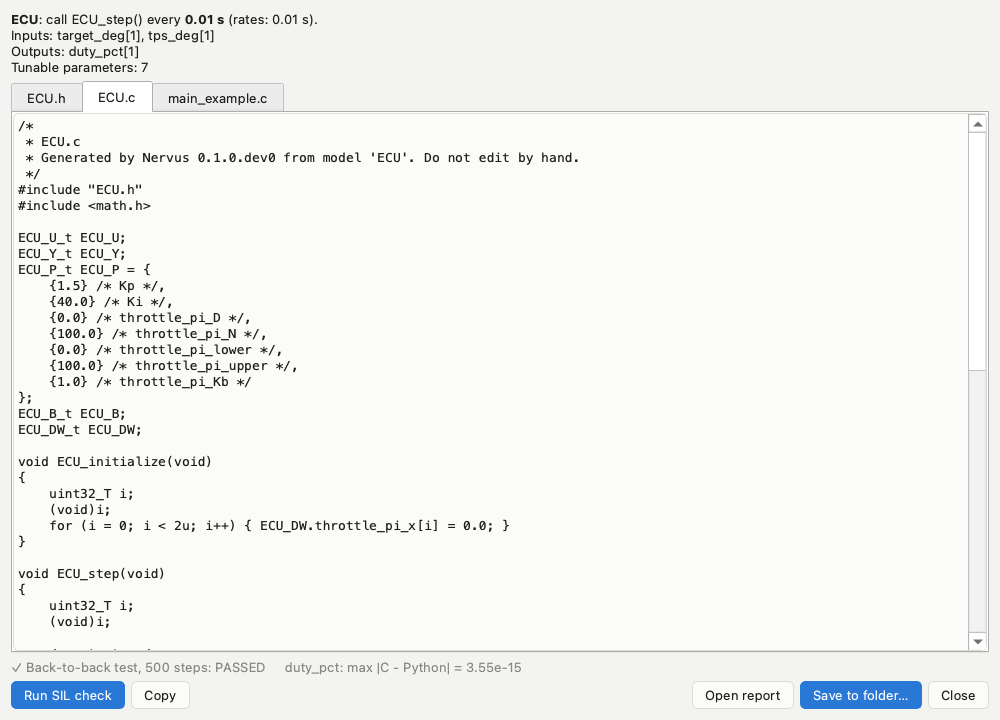

# C code generation

Nervus generates plain C99 code from the discrete-time part of a model, the way Simulink Embedded Coder
does. The code uses only static memory (no `malloc`, no recursion). It is verified against the model by a
**back-to-back (software-in-the-loop) test** that compiles it and compares every output at every step.



## Workflow

1. Put everything that runs on the ECU in a **subsystem**. Its In/Out blocks are the software interface
   (sensors in, actuators out). The plant stays outside and is not generated.
2. Make sure the subsystem is **discrete-time**: give the controller blocks a sample time (e.g. `Ts = 0.01`)
   and use a Zero-Order Hold where a continuous signal enters.
3. Select the subsystem and choose **Code → Generate C Code…** (⌘B / Ctrl+B). With nothing selected, the
   whole model is generated.
4. Press **Run SIL check**: the code is compiled with `-Wall -Wextra -Werror -pedantic`, driven with the same
   random input sequence as the model, and the largest difference is reported.
5. **Save to folder…** writes the files. **Open report** shows an HTML report with the interface, the
   parameters and links from every block to its lines of code.

The example [`examples/throttle_ecu.py`](https://github.com/ikjbi/nervus/blob/main/examples/throttle_ecu.py)
does all of this from Python. Its generated code is committed in
[`examples/generated/ECU/`](https://github.com/ikjbi/nervus/tree/main/examples/generated/ECU).

## Generated files

| File | Contents |
|---|---|
| `<name>.h` | types, the input/output/parameter/state structs, and the API |
| `<name>.c` | `<name>_initialize()` and `<name>_step()` |
| `main_example.c` | a template showing how to call the code from a periodic task |
| `<name>_sil.c` | accessors used only by the software-in-the-loop test |
| `<name>_report.html` | the code generation report |
| `<name>.a2l` | ASAM MCD-2 MC description for calibration tools (INCA, CANape, ...) |

Only `<name>.h` and `<name>.c` belong in the ECU project.

## The API

```c
#include "ECU.h"

void task_10ms(void)            /* every ECU_BASE_PERIOD seconds */
{
    ECU_U.target_deg[0] = pedal_map_output;
    ECU_U.tps_deg[0]    = read_throttle_sensor();
    ECU_step();
    set_hbridge_duty(ECU_Y.duty_pct[0]);
}

int main(void)
{
    ECU_initialize();
    start_timer(task_10ms, ECU_BASE_PERIOD);
    for (;;) { }
}
```

| Symbol | Meaning |
|---|---|
| `<name>_U` | inputs, one array per In block (write before each step) |
| `<name>_Y` | outputs, one array per Out block (read after each step) |
| `<name>_P` | **tunable parameters** (calibration data) |
| `<name>_B` | block signals (useful for measurement) |
| `<name>_DW` | states (delays, integrators, filters, ...) |
| `<NAME>_BASE_PERIOD` | how often to call `<name>_step()`, in seconds |

### Calibration parameters

A block parameter written as a **bare workspace variable** (`Kp`) becomes one shared field
`<name>_P.Kp`, so every block that uses `Kp` reads the same value and a calibration tool can change it at run
time. Other parameters get a field per block (`<name>_P.throttle_pi_N`). See
[Workspace and calibrations](workspace.md).

### What a step looks like

This is `ECU_step()` from the throttle example. Each block is a short commented section, in execution order:

```c
void ECU_step(void)
{
    uint32_T i;
    (void)i;

    /* outputs */
    /* target_deg (In) */
    ECU_B.target_deg[0] = ECU_U.target_deg[0];
    /* tps_deg (In) */
    ECU_B.tps_deg[0] = ECU_U.tps_deg[0];
    /* tps_sample (Zero-Order Hold) */
    ECU_B.tps_sample[0] = ECU_B.tps_deg[0];
    /* error (Sum) */
    ECU_B.error[0] = ECU_B.target_deg[0] - ECU_B.tps_sample[0];
    /* throttle_pi (Discrete PID Controller) */
    {
        real_T err = ECU_B.error[0];
        real_T d_term = ECU_P.throttle_pi_D[0] * ECU_P.throttle_pi_N[0] * (err - ECU_DW.throttle_pi_x[1]);
        real_T unsat = ECU_P.Kp[0] * err + ECU_DW.throttle_pi_x[0] + d_term;
        real_T y = fmin(fmax(unsat, ECU_P.throttle_pi_lower[0]), ECU_P.throttle_pi_upper[0]);
        ECU_B.throttle_pi[0] = y;
    }
    /* duty_pct (Out) */
    ECU_Y.duty_pct[0] = ECU_B.throttle_pi[0];

    /* state updates */
    /* throttle_pi (Discrete PID Controller) */
    {
        real_T err = ECU_B.error[0];
        real_T d_term = ECU_P.throttle_pi_D[0] * ECU_P.throttle_pi_N[0] * (err - ECU_DW.throttle_pi_x[1]);
        real_T unsat = ECU_P.Kp[0] * err + ECU_DW.throttle_pi_x[0] + d_term;
        real_T y = fmin(fmax(unsat, ECU_P.throttle_pi_lower[0]), ECU_P.throttle_pi_upper[0]);
        real_T di = ECU_P.Ki[0] * err;
        if ((unsat != y) && (((unsat - y) > 0.0) == (di > 0.0)) && (di != 0.0)) { di = 0.0; }
        ECU_DW.throttle_pi_x[0] += 0.01 * di;
        ECU_DW.throttle_pi_x[1] += 0.01 * ECU_P.throttle_pi_N[0] * (err - ECU_DW.throttle_pi_x[1]);
    }
}
```

## Calibration with A2L

`<name>.a2l` describes every tunable parameter as a `CHARACTERISTIC` and every block signal as a
`MEASUREMENT`, all `FLOAT64_IEEE`. Units, limits and descriptions come from the
[workspace variables](workspace.md), so `Kp` with unit `%/°` and range 0–10 appears exactly like that in the
calibration tool.

Memory addresses are only known after linking. The file contains placeholders, and these lines fill them in
from the built ECU binary:

```python
from nervus.codegen.a2l import fill_addresses, symbol_addresses

a2l = code.files["ECU.a2l"]
a2l = fill_addresses(a2l, symbol_addresses("build/ecu.elf"))  # uses `nm`
```

## Multi-rate models

When blocks run at different rates (e.g. 10 ms and 50 ms), `<name>_step()` is called at the **base rate**
(the greatest common divisor of the periods). Rate counters decide which blocks run in each step:

```c
for (i = 0; i < 2u; i++) { rt_hit[i] = (rt_count[i] == 0u); }
...
if (rt_hit[1]) {        /* blocks of the 50 ms rate */
    ...
}
```

## Supported blocks

**Supported:** 1-D/2-D Lookup Table, Abs, Bias, Compare To Constant, Constant, Counter, Dead Zone, Debounce, Demux, Discrete Filter (PT1), Discrete PID Controller, Discrete Transfer Fcn, Discrete-Time Integrator, Edge Detect, Gain (elementwise and matrix), Ground, In, Integer Delay, Logical Operator, Math Function, MinMax, Moving Average, Mux, Out, Product, Quantizer, Rate Limiter, Relational Operator, Relay, Saturation, Subsystems, Sum, Switch, Unit Delay, Zero-Order Hold (Scope, To Workspace and Terminator are ignored).

**Not supported** (simulation only): blocks with continuous states (Integrator, Transfer Fcn, State-Space,
PID Controller, Derivative), time-based sources (Step, Sine Wave, Ramp, Pulse, Clock, From Workspace) and
Python Function. Put these in the plant model outside the generated subsystem, or use their discrete
counterparts (Discrete-Time Integrator, Discrete Transfer Fcn, Discrete PID Controller).

Custom blocks can provide their own C template with `@nervus.codegen.template("my.block_type")`.

## Current limitations

- Integer and fixed-point types are supported at the interface and are bit-true (see
  [Data types](datatypes.md)), but arithmetic between conversions is done in `double`.
- Discrete blocks with a sample-time **offset** start in their first hit; their output before the
  first hit is 0 in the generated code.
- MISRA C checking (cppcheck) and XCP (live measurement and calibration over CAN) are planned.

## From Python

```python
from nervus import load
from nervus.codegen import generate_c
from nervus.codegen.sil import back_to_back

model = load("examples/throttle_ecu.nervus")
code = generate_c(model.block("ECU"))
code.write("build/ECU")

result = back_to_back(model.block("ECU"), {"target_deg": 60.0, "tps_deg": 5.0}, steps=500)
print(result.summary())
```
