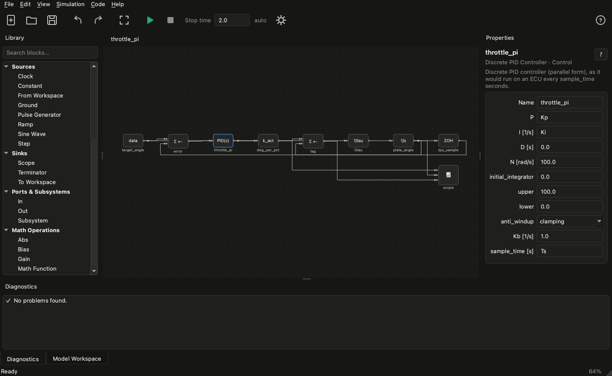

# The editor

Start the desktop editor with:

```bash
uv sync --extra gui
uv run nervus                         # empty model
uv run nervus examples/throttle_pi.nervus
```


| Area | What it does |
|---|---|
| **Toolbar** | New / open / save, undo / redo, fit to window, **▶ Run** and **■ Stop**, the stop time, and the simulation settings. |
| **Library** (left) | All blocks by category, with search. Drag a block onto the canvas or double-click it. |
| **Canvas** (centre) | The diagram. Drag from an output port (▸ on the right of a block) to an input port to draw a line. |
| **Properties** (right) | Parameters of the selected block. Fields accept expressions (`2*pi`) and MATLAB-style matrices (`[1 2; 3 4]`). |
| **Model Workspace** (bottom, tab) | Named parameters (calibration data) that block parameters can use, and parameter sets. See [Workspace and calibrations](workspace.md). |
| **Test Manager** (bottom, tab) | Test cases saved with the model; run them and see pass/fail. See [Test cases and results](testing.md). |
| **Diagnostics** (bottom) | Problems such as unconnected inputs or algebraic loops. Click one to select the blocks involved; they also get a red outline. |

Dark mode follows the system setting, or choose it under **View → Theme**:



## Right-click menus

Right-click a block, a wire or the empty canvas for the actions that fit it:


| On | Actions |
|---|---|
| a block | Rename, help, cut / copy / delete, create a subsystem from the selection; *Open Scope* for scopes |
| a subsystem | also *Open Subsystem*, *Edit Mask…*, *Variants…*, *Save Subsystem to Library…*, *Generate C Code…* (or *Break Library Link* when it is linked) |
| a wire | *Delete Wire* |
| the canvas | paste, select all, auto layout, fit to window, up to the parent system |

Right-clicking a block that is part of a selection keeps the selection, so *Delete* or *Create Subsystem*
act on all selected blocks.

## Running a simulation

Press **▶ Run** (⌘R / Ctrl+R / F5). The simulation runs in the background, so the window stays responsive,
and **■ Stop** ends it early. Every Scope opens after the first run. Hover over a plot to read the values
at that time:


Solver, step size and tolerances are under **Simulation → Simulation Settings…** (⌘E):


## Built-in help

**Help → Nervus Help** opens the guide and the full block reference inside the app. Select a block and press
**F1** (or **?** in the Properties panel) to jump straight to its page. Equations are typeset, and many blocks
have explanatory figures:


The in-app guide pages are also available here:
[Getting started](app-help/getting_started.md) ·
[Using the editor](app-help/editor.md) ·
[Running simulations](app-help/simulation.md) ·
[Workspace and calibrations](app-help/workspace.md) ·
[Keyboard shortcuts](app-help/shortcuts.md)

## Troubleshooting

**"Could not find the Qt platform plugin"** on macOS: some tools mark every file inside `.venv` as *hidden*,
and Qt skips hidden plugin files. Nervus clears that flag automatically when it starts. If you start Qt some
other way, run `chflags -R nohidden .venv`.
