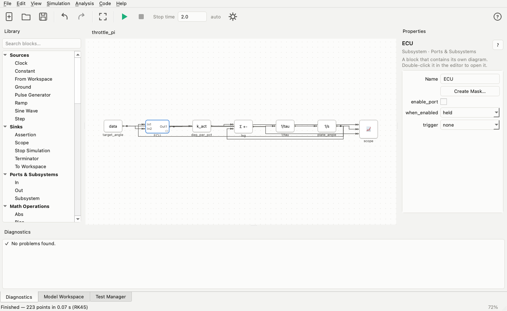
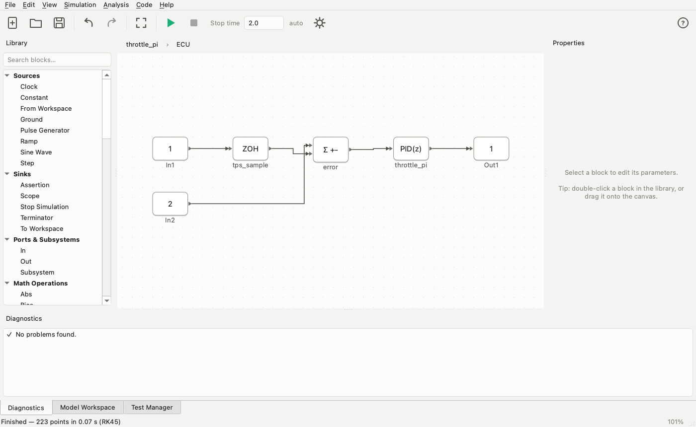
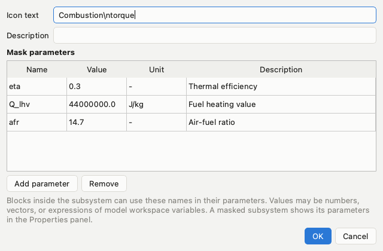
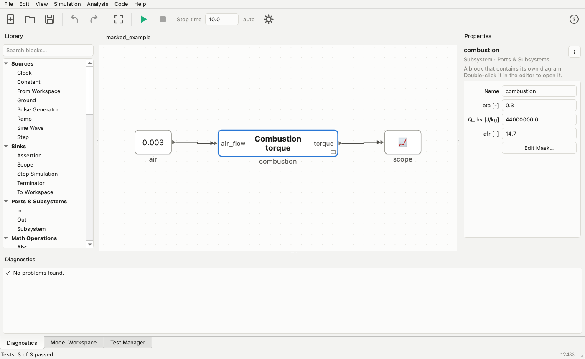

# Subsystems

A **subsystem** is a block that contains its own diagram. Subsystems structure a model the way functions
structure code. In ECU work, each subsystem is typically one software function (throttle control, fuel,
ignition), and the generated C code will follow that structure.

Here the throttle example is grouped so that everything running on the ECU (sensor sampling, error and
PI controller) is inside one subsystem:



Double-click it to open it. The breadcrumb bar shows the path back to the model:



## In the editor

| Action | How |
|---|---|
| Group blocks into a subsystem | select them, **Edit → Create Subsystem from Selection** (⌘G / Ctrl+G) |
| Open a subsystem | double-click it |
| Go back up | click a breadcrumb, or **View → Up to Parent** (⌘↑ / Ctrl+Up) |
| Add an empty subsystem | **Library → Ports & Subsystems → Subsystem** |

Lines crossing the selection boundary become **In**/**Out** ports. Undo works across levels and opens the
subsystem where the change is undone.

## Enabled subsystems

Tick *enable_port* in a subsystem's Properties to give it an extra last input, **⏻ enable**. While the
enable is ≤ 0 nothing inside runs: outputs and discrete states are held, and continuous states stop. Typical
use: a function that only runs in one operating mode, with the enable coming from a State Chart's mode output.

| *when_enabled* | Discrete states when enabled again |
|---|---|
| `held` (default) | continue from where they stopped |
| `reset` | restart from their initial values |

The enable is decided once per time step (when the blocks inside execute) and held during solver
sub-steps. The generated C wraps the subsystem's blocks in `if (enabled)` and resets their states the same
way, which the test suite checks against the simulation with zero tolerance.

## Masks: reusable components with parameters

A **masked** subsystem has its own parameters, like a function's arguments. The blocks inside use them in
their expressions, and each copy of the subsystem can have different values. This is how you build
reusable components such as an engine model with a `displacement` parameter.

Select a subsystem and press **Create Mask…** (or **Edit Mask…**) in the Properties panel:



- **Mask parameters**: name, value, unit and description. Values can be numbers, vectors, or expressions of
  model workspace variables (`3 * base`).
- **Icon text**: shown on the block; `\n` starts a new line.
- **Description**: shown in the Properties panel.

The parameters then appear in the Properties panel of the subsystem, like the parameters of any block:



Names are looked up from the inside out: a block sees the parameters of the nearest mask first, then those
of outer masks, then the model workspace. In generated C, mask parameters are per-instance values. Only bare
**model workspace** variables become shared calibration parameters.

```python
from nervus.core import Variable

engine = Subsystem(system=engine_diagram)
engine.mask.add(Variable("displacement", 1.6e-3, "Swept volume", "m³"))
engine.mask_icon = "Engine\\n1.6 l"
```

## In Python

```python
from nervus import Diagram, simulate
from nervus.blocks import Gain, Inport, Integrator, Outport, Scope, Step, Subsystem, Sum

plant = Diagram("plant")
u = plant.add(Inport(port=1), name="u")
e = plant.add(Sum(signs="+-"), name="e")
k = plant.add(Gain(gain="1/tau"), name="k")  # uses the model workspace
y = plant.add(Integrator(), name="y")
plant.connect(u, (e, 0))
plant.connect(y, (e, 1))
plant.chain(e, k, y, plant.add(Outport(port=1), name="y_out"))

model = Diagram("model")
model.workspace["tau"] = 0.5
sub = model.add(Subsystem(system=plant), name="plant")
model.chain(model.add(Step(time=0.0)), sub, model.add(Scope()))

res = simulate(model, 2.0)
res["plant/y"]  # blocks inside subsystems are named by path
```

## How it works

Before simulation, the compiler **flattens** the hierarchy. The In and Out blocks inside subsystems become
identity nodes, so sorting, signal widths and sample times work across subsystem boundaries exactly as in a
flat model. Every block keeps its path name for results and error messages.

In model files, a subsystem block carries its diagram in a nested `"system"` entry (schema version 3).
