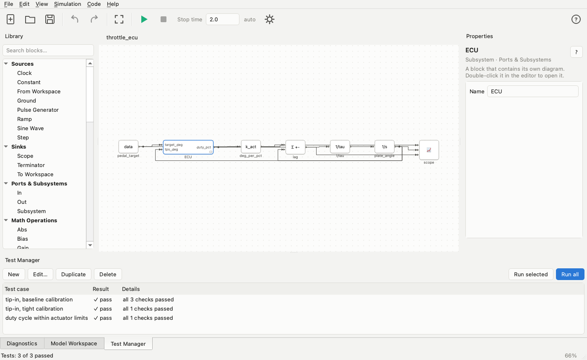
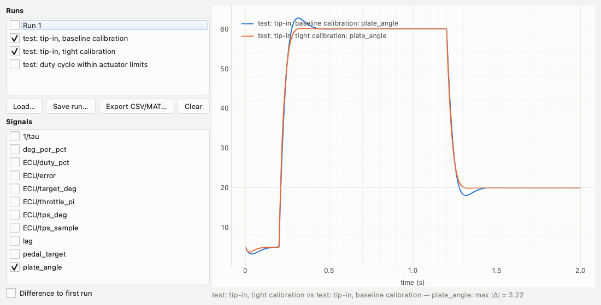

# Test cases, scenarios and results

Model-based development lives on **reproducible tests**: the same scenario, run after every change, with
clear pass/fail criteria. In Nervus a **test case** is saved with the model and contains:

- **inputs**: time signals for the model's top-level **In** blocks (the scenario),
- **parameters**: workspace overrides and/or a parameter-set file (the calibration under test),
- a **stop time**,
- **checks**: what must be true about the results.



## In the editor

Open the **Test Manager** tab (next to Diagnostics):

| Button | Does |
|---|---|
| New / Edit… | opens the test case editor: inputs, parameter overrides, parameter set, stop time, checks |
| Duplicate / Delete | as named; every change is undoable and saved with the model |
| Run selected / Run all | runs the tests in the background (**Simulation → Run All Tests**, ⌘T) |

The *Result* column shows ✓ pass / ✗ fail. *Details* names the failing check and why ("reached at
t = 0.41"). Double-click a result to open it in the **Data Inspector**.

### Inputs

In the test case editor, every top-level In block has a row. Enter points as `time: value` pairs:

```
0: 5, 0.2: 60, 1.2: 20
```

With *interpolation* `hold` this is a staircase (5 until 0.2 s, then 60, then 20); with `linear` it ramps
between the points. Vector inputs use `[ ]`: `0: [1 2], 1: [3 4]`. Leave a row empty to use the In block's
own *value*.

### Checks

| Check | Arguments | Passes when |
|---|---|---|
| `bounds` | `lower`, `upper`, optional `t_from`, `t_to` | the signal stays within [lower, upper] (in the time window) |
| `final_value` | `value`, `tolerance` | the last value is value ± tolerance |
| `reaches` | `value`, `before`, optional `direction=below` | the signal reaches the value before the given time |
| `max` / `min` | `value` | the maximum is at most / the minimum is at least the value |
| `baseline` | `path`, `tolerance` | the signal matches a saved result file within the tolerance (regression test) |

Signals are named as in results: `plate_angle`, `ECU/throttle_pi`, `mux:1`.

## Data Inspector

**Simulation → Data Inspector** (⌘I) keeps the last 20 runs, both normal simulations and test results.
Check runs and signals to overlay them. With two runs selected it shows the largest difference, and
*Difference to first run* plots the deviation directly. *Save run…* writes a `.nervres` file (use it as a
baseline), *Load…* reads one, and *Export* writes CSV or MATLAB `.mat`.



## In Python

```python
from nervus import load, simulate
from nervus.core import Check, Signal, TestCase
from nervus.testing import compare_results, run_tests

model = load("examples/throttle_ecu.nervus")
for result in run_tests(model, base_dir="examples"):  # the tests stored in the model
    print(result.summary())

# A scenario for a top-level In block called "pedal":
res = simulate(model, inputs={"pedal": Signal.steps([(0, 5), (0.2, 60)])})

# Results
res.save("baseline.nervres")
res.to_mat("run.mat")  # for MATLAB users
old = type(res).load("baseline.nervres")
print(compare_results(res, old))  # max |difference| per signal

# A new test case
case = TestCase(
    "tip-in",
    parameter_set="throttle_tight.nervcal",
    checks=[Check("reaches", "plate_angle", {"value": 59.0, "before": 0.35})],
)
model.tests.append(case)
```

Because tests are plain Python objects, the same checks work inside **pytest**, which is how you run model
regression tests in CI. The Nervus repository does exactly that for the examples.

### Signals from logged data

`Signal.from_csv("drive_log.csv", "rpm")` reads a column of a CSV file (first column = time), for example
data exported from a vehicle logger, to replay a real drive as a test input. Reading ASAM MDF4 logs directly
is on the [roadmap](https://github.com/ikjbi/nervus/blob/main/plan.md).
