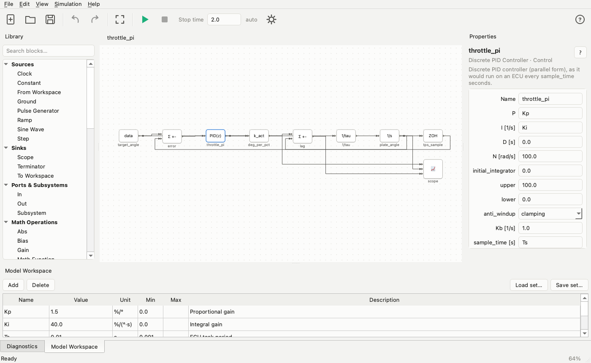

# Model workspace and calibrations

Engine control software is *code plus calibration*. Nervus keeps the two apart: block parameters can refer
to named **workspace variables**, and the values of those variables can be saved and loaded as **parameter
sets** (`.nervcal` files).


## Variables

Each variable has a name, a value, and optional unit, minimum, maximum and description. A value can be:

- a number: `1.5`
- a vector or matrix: `[1 2 3]`, `[1 2; 3 4]` (MATLAB style) or `[[1, 2], [3, 4]]`
- an expression of variables defined **above** it: `Kp / Ti`, `2*pi*f_c`

Values outside `[min, max]` are reported as warnings in Diagnostics. These ranges will also go into the A2L
calibration file once that exists (see the [roadmap](https://github.com/ikjbi/nervus/blob/main/plan.md)).

## Block parameters as expressions

Any numeric parameter (numbers, vectors, matrices, sample times) can be an expression of workspace
variables:

```python
from nervus import Diagram
from nervus.blocks import DiscretePID, Gain, ZeroOrderHold
from nervus.core import Variable

d = Diagram()
d.workspace.add(Variable("Kp", 1.5, "Proportional gain", "%/°", min=0))
d.workspace["Ti"] = 0.04
d.workspace["Ts"] = 0.01
pid = d.add(DiscretePID(P="Kp", I="Kp/Ti", sample_time="Ts"))
```

Expressions are stored in the model file exactly as written and evaluated every time the model is compiled.
In the editor, the canvas shows the expression (e.g. `Kp`) instead of the number:



Expressions may use `+ - * / ** %`, the functions `sqrt`, `exp`, `log`, `sin`, `cos`, `abs` and the
constants `pi`, `e`, `inf`, `true` and `false`. Comparisons (`==`, `!=`, `<`, `<=`, `>`, `>=`) and `and`, `or`, `not` give 1 (true)
or 0 (false), so `Kp * (MODE == 2)` works. The MATLAB spellings `~=`, `&&`, `||` and `~` are accepted too.

## Autocompletion and Find Usages

While you type a parameter in the Properties panel, the names of the variables the block can see (the model
workspace and the masks around it) pop up; Enter or a click completes the word under the cursor, so
`Kp / T` becomes `Kp / Ti`.

Select a variable in the **Model Workspace** and press **Find Usages** to list every place that uses it: block
parameters (`gain = 1 / r_wheel`), State Chart `param` declarations, mask variables, variant conditions and
other workspace variables. Double-click a row to open the subsystem and select the block. Inside a masked
subsystem whose mask defines the same name, the mask's own variable is meant, so those blocks are not
listed. From Python: `d.usages("r_wheel")`.

## Calibration maps over shared axes

ECU software is full of curves and maps over the same few axes: engine speed, load, coolant temperature.
For one map, use a **1-D** or **2-D Lookup Table**. When several maps share an axis, use a **Prelookup**
block per axis and an **Interpolation using Prelookup** block per map: the breakpoint search runs once, and
every map reuses its result (index *k* and fraction *f*).


Put the axes and tables in the workspace, so they can be calibrated and swapped with parameter sets:

```python
d.workspace["speed_axis"] = [800, 1500, 3000, 6000]  # rpm
d.workspace["load_axis"] = [0.2, 0.5, 1.0]
d.workspace["ign_map"] = [[10, 8, 5], [20, 16, 10], [30, 25, 18], [35, 30, 22]]  # ° before TDC
speed = d.add(Prelookup(breakpoints="speed_axis"))
load = d.add(Prelookup(breakpoints="load_axis"))
ign = d.add(Interpolation(dimensions=2, table="ign_map"))  # inputs: k1, f1, k2, f2
```

The result is identical to a 2-D Lookup Table with linear interpolation, in the simulation and in the
generated C. Hover over the Interpolation block's ports to see which input is which.

## Data types and constants for the ECU

Two columns of the Model Workspace control how a variable ends up in generated C code:

| Column | Meaning | Example |
|---|---|---|
| **Type** | the storage type in C: `double` (default), `single`, `int8` … `uint32`, `boolean`, or fixed point `fixdt(signed, bits, fraction_bits)` | an ignition map as `fixdt(1,16,7)`: 2 bytes per value, steps of 1/128 ° |
| **Cal.** | ticked: calibratable, in RAM and in the A2L file. Unticked: a constant in ROM (flash), not in the A2L file | a sensor's fixed conversion factor |

Smaller types matter on an ECU: a 16 × 16 map takes 2 KB as `double` but 512 bytes as `int16`. The
simulation uses exactly the value the type can hold (hover over the value to see it), so the model and the
generated C stay bit-true. In C, the parameter is stored as integers and scaled where a block reads it:

```c
/* ign_map: fixdt(1,16,7): value = 0.0078125 * stored + 0 */
int16_T ign_map[12];
...
y = ((real_T)ign_P.ign_map[(r) * 3u + (c)] * 0.0078125 + 0.0) ...
```

The A2L file describes the stored type (e.g. `SWORD`) and the scaling (`COEFFS_LINEAR`), so a calibration
tool such as INCA or CANape shows and edits physical values. Typed parameters work for scalar parameters
(gains, limits, thresholds) and for lookup tables and their breakpoints. Matrix parameters (matrix gains,
state-space matrices) must stay `double`.

```python
from nervus.core import Variable

ws.add(Variable("ign_map", ign, "Ignition advance", "°", data_type="fixdt(1,16,7)"))
ws.add(Variable("speed_axis", [800, 1500, 3000, 6000], unit="rpm", data_type="uint16"))
ws.add(Variable("k_sensor", 0.0125, "ADC to volts", "V", calibratable=False))  # const, in ROM
```

## Parameter sets

```python
from nervus import ParameterSet, load, simulate

d = load("examples/throttle_pi.nervus")
ParameterSet.from_workspace(d.workspace, "baseline").save("baseline.nervcal")

d.workspace.apply(ParameterSet.load("examples/throttle_tight.nervcal").values)
res = simulate(d)

res = simulate(d, params={"Kp": 2.0})  # temporary override for a single run
```

A `.nervcal` file is plain JSON:

```json
{
  "format": "nervus-parameters",
  "schema_version": 1,
  "name": "tight",
  "description": "Higher gains: less overshoot",
  "values": {"Kp": 3.0, "Ki": 80.0}
}
```

In the editor, use **Load set…** / **Save set…** in the Model Workspace panel. Loading is a single undo step.
