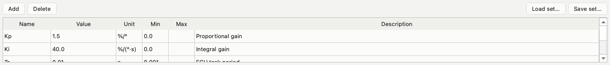

# Model workspace and calibrations

Engine control software is *code plus calibration*. Nervus keeps the two apart: block parameters can refer
to named **workspace variables**, and the values of those variables can be saved and loaded as **parameter
sets** (`.nervcal` files).



## Variables

Each variable has a name, a value, and optional unit, minimum, maximum and description. A value can be:

- a number: `1.5`
- a vector or matrix: `[1 2 3]`, `[1 2; 3 4]` (MATLAB style) or `[[1, 2], [3, 4]]`
- an expression of variables defined **above** it: `Kp / Ti`, `2*pi*f_c`

Values outside `[min, max]` are reported as warnings in Diagnostics. These ranges will also go into the A2L
calibration file once that exists (see the [roadmap](https://github.com/ikjbi/nervus/blob/main/plan.md)).

## Block parameters as expressions

Any numeric parameter (numbers, vectors, matrices, sample times) can be an expression of workspace
variables:

```python
from nervus import Diagram
from nervus.blocks import DiscretePID, Gain, ZeroOrderHold
from nervus.core import Variable

d = Diagram()
d.workspace.add(Variable("Kp", 1.5, "Proportional gain", "%/°", min=0))
d.workspace["Ti"] = 0.04
d.workspace["Ts"] = 0.01
pid = d.add(DiscretePID(P="Kp", I="Kp/Ti", sample_time="Ts"))
```

Expressions are stored in the model file exactly as written and evaluated every time the model is compiled.
In the editor, the canvas shows the expression (e.g. `Kp`) instead of the number:


## Parameter sets

```python
from nervus import ParameterSet, load, simulate

d = load("examples/throttle_pi.nervus")
ParameterSet.from_workspace(d.workspace, "baseline").save("baseline.nervcal")

d.workspace.apply(ParameterSet.load("examples/throttle_tight.nervcal").values)
res = simulate(d)

res = simulate(d, params={"Kp": 2.0})  # temporary override for a single run
```

A `.nervcal` file is plain JSON:

```json
{
  "format": "nervus-parameters",
  "schema_version": 1,
  "name": "tight",
  "description": "Higher gains: less overshoot",
  "values": {"Kp": 3.0, "Ki": 80.0}
}
```

In the editor, use **Load set…** / **Save set…** in the Model Workspace panel. Loading is a single undo step.
